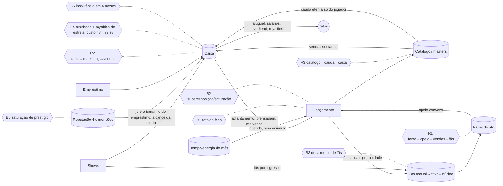
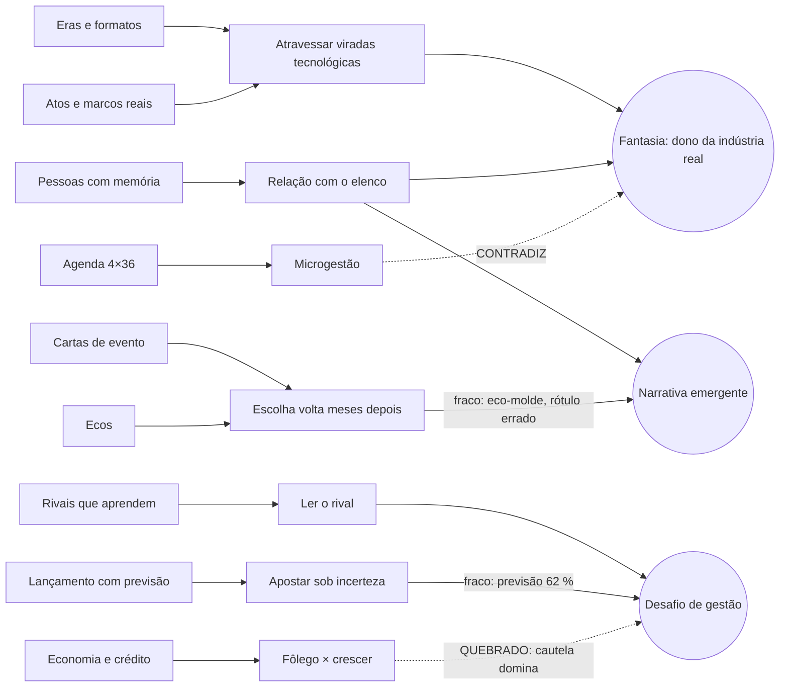

# Análise "Teoria de Tudo" — Masters (2026-10-12)

Escopo: **completa** (16 camadas) + verificação de tudo o que já foi pedido em `rodada20`, `rodada19`, `plano19`, `revisao18`, `verificacao19` e `ideias19`.
Método:
- Leitura de README, docs e código (5 frentes em paralelo, cada achado com `arquivo:linha`).
- Medição:
  - `npm run typecheck`; `npx vitest run` (suíte inteira);
  - `npm run balance -- --quick --det` (6 seeds × 3 anos + 1 repetida);
  - `npm run balance -- --full` (4 perfis + 6 adversários, 6 seeds × 5 anos; resultado no apêndice C).
- Sondagens tsx no scratchpad, já apagadas, todas com `createGame` + `playbot16.playMonth` + `advanceMonth`:
  - 3 perfis × 4 seeds × 6 anos (1955);
  - 2 × 10 anos com DRE anual;
  - determinismo com salvar/carregar e desfazer;
  - atribuição das mudanças de reputação;
  - cobertura de ecos e dicas nas 796 definições de evento;
  - política de cartas (bot × sempre padrão × pior escolha);
  - Diário e repetição em 1 × 20 anos (1962) e 1 × 5 anos (1889);
  - tempo por mês.
- Inspeção visual com Playwright e Chromium:
  - 1400 px e 390 px, Tab, zoom 200 %, alto contraste e forced-colors;
  - 12 meses jogados no browser;
  - ~45 capturas guardadas fora do repositório.

Limites:
- As sondagens de política têm 1–2 seeds por condição. Servem como sinal, não como medida.
- A máquina estava carregada (4 núcleos, carga de 9 a 16). Tempos de relógio estão inflados; usei CPU quando possível.
- Nenhuma partida foi jogada até 2040. O leitor de tela real não foi testado. Não houve teste com jogadores.
- "Nunca aconteceu" quer dizer "não apareceu nesta amostra".
- Tags: [O] Observado (lido ou medido), [I] Inferido (dedução direta do código), [H] Hipótese.

---

## Veredito

O Masters é o simulador de indústria musical mais profundo que se pode imaginar. Tem 150 anos de história, eras que mudam as regras, pessoas com memória e decisões que voltam. O que já foi pedido está quase todo feito: 169 de 216 itens conferidos no código.

O que mais segura o jogo não é falta de sistema. São três promessas que os próprios pilares fazem e o código ainda não cumpre:
- **incerteza legível**: chances mostradas erradas ou escondidas;
- **run reproduzível**: carregar o save muda o futuro;
- **risco que vale a pena**: a cautela domina.

O modo padrão "Reais em mundo aleatório", em que tudo pode acontecer com pessoas reais, é **intenção declarada do autor** e foi tratado como tensão, não como defeito. Para a escolha ficar sólida, faltam filtros que funcionem, documentação coerente e um aviso de ficção (C1).

Há também uma regressão medida agora: o perfil equilibrado quebra em 50 % das partidas do lote completo, contra 17 % na R19. Um teste (`r16-playbot`) está vermelho desde a recalibração do choque do petróleo.

O que mais levantaria o jogo: cumprir essas três promessas com regras centrais (poucas, quase todas S), cortar o ruído que esconde a história do jogador e trazer o primeiro sucesso e o fim de partida para perto.

## Painel das 16 camadas

| # | Camada | Nota | Uma frase |
|---|---|---|---|
| 1 | Identidade e pilares | 2 | A fantasia é clara, mas os pilares não estão escritos (nem o do modo aleatório com reais); há 2 sistemas órfãos (bolsa, vícios do jogador) e a 1ª hora é um tour |
| 2 | MDA | 3 | Fantasia histórica forte; o desafio é minado pela estratégia "gastar pouco" e a narrativa pelo eco-molde |
| 3 | Diversão / maestria | 3 | Eras e rivais renovam, mas "gaste pouco" se aprende cedo e o ruído esconde o valor das escolhas |
| 4 | Fluxo e ritmo | 2 | Curva em degrau: todo o risco nos anos 1–3 (equilibrado quebra em 50 % no lote completo, regressão da R19), depois platô de margem zero |
| 5 | Motivação | 3 | Autonomia e pertencimento fortes; competência minada por rótulos de incerteza errados; social ausente |
| 6 | Decisões | 3 | 6 de 18 decisões amostradas são interessantes; as cartas mais sorteadas são as menos informadas |
| 7 | Teoria dos jogos | 3 | Sem exploit grande, mas arriscar é dominado, promessas de contrato são grátis e rivais espelham o seu lance |
| 8 | Sistemas e economia | 3 | Estável e cheia de freios; meio de jogo parado, reputação sem torneira, catálogo do jogador eterno |
| 9 | Probabilidade | 2 | Salvar/carregar muda o futuro, a sorte do lançamento é rerrolável e a previsão erra 4 em 10 sem avisar |
| 10 | Narrativa | 3 | Sistemas geram muito material, mas o Diário se afoga em #1 alheios e há incoerências de época |
| 11 | UX e acessibilidade | 3 | Bloqueios explicam o motivo e 200 %/390 px funcionam; onboarding em 5 camadas e alto contraste que piora |
| 12 | Estética e sensação | 2 | Pixel art de época bonita; o jogo é mudo (motor de áudio órfão) e o fim não tem peso |
| 13 | Sessão e retenção | 3 | Metas nos 3 horizontes; padrão sem prazo (1962→2040 = 936 meses) e sessão picotada |
| 14 | Saúde técnica | 3 | Typecheck limpo, 938/949 testes; suíte de 26 min frágil, ~1 s de CPU por mês, fachadas que não substituem |
| 15 | Ética e representação | 3 | Cuidado real (consentimento, contexto histórico); reais em qualquer história é escolha do autor; filtros que vazam, gangues por gênero e barreira racial sem opção |
| 16 | Mercado e escopo | 2 | Posição única; o escopo cresce ~100 arquivos por rodada sem orçamento; nomes reais ligados por padrão |

Média geral: **2,7**. Por grupo:
- Sistema (2, 7, 8, 9): 2,75
- Mente (3, 4, 5, 6): 2,75
- Superfície (10, 11, 12): 2,7
- Tempo e contexto (1, 13, 14, 15, 16): 2,6

---

## Cadeias causais

As 8 cadeias abaixo explicam a maior parte dos ~70 achados. Estão ordenadas por prioridade, exceto a C1, que foi rebaixada de P0 para P1 depois que o autor confirmou que o modo aleatório com pessoas reais é intencional.

### C1. Mundo aleatório com pessoas reais: a escolha precisa ficar sólida (P1)
**Intenção declarada pelo autor:** um modo aleatório em que tudo pode acontecer, com pessoas reais. Portanto, crimes, vícios, casos e mortes envolvendo reais fora do modo "Fidelidade histórica" **não são defeito**: são o modo.

O que segue é o que falta para a escolha funcionar como produto.

- **Origem:**
  - O padrão é "Reais em mundo aleatório" (`realNames: true`, `history: 'free'`, `src/sim/start17.ts:18-23`). As proteções de pessoa real valem só no modo exato (`crime17.ts:444`, `crimenpc17.ts:30, 296-300`, `love17.ts:104`) [O]. Coerente com a intenção.
  - **Os filtros escolhidos pelo jogador não chegam a todos os sistemas.** "Crimes" e "Drogas" não são lidos por `crime17`, `crimenpc17` nem `lifecycle7` (`lifecycle7.ts:247-270`). O teste de filtros só cobre `events.ts` (`sim.test.ts:80`) [O]. Esse é um defeito real: quem desliga "Crimes" ainda vê crimes.
  - **A documentação diz o contrário da intenção:**
    - `crime17.ts:7`: "assassinato nunca envolve pessoa real";
    - `README.md:217`: "por padrão o universo é ficcional";
    - `realnames.ts:1`: "opcional, para uso pessoal".
    - [O]
  - **Não há aviso de ficção** na nova run nem nas manchetes sensíveis. O selo **Documentado/Simulado** (`provbadge20.ts`) existe para lançamentos, mas não marca fatos de crime, vício ou caso [O/I].
  - **Contradições de ordem de resolução:** "The Carter Family segue em frente" × "decide encerrar" na mesma semana [O, browser]. Mortos reais voltam à ativa ("Robert Johnson chega ao #1" em 1962), o que é coerente com "tudo pode acontecer", mas a tela de revisão não avisa [O].
- **Dinâmica:** o modo gera as histórias mais fortes do jogo, como o assassinato de um ídolo por uma rixa de gangue ou a recaída de uma lenda. Só que filtros furados e textos contraditórios fazem essas histórias parecerem bug, não escolha.
- **Experiência:** quem quer o caos tem; quem desligou um tema é surpreendido.
- **Contexto:**
  - Risco de imagem e de direito de personalidade de vivos e espólios ao **publicar** [H; não é parecer jurídico].
  - Possível barreira de loja [H].
  - Não muda a intenção, mas pede mitigação: aviso claro, selo "Simulado" e, se for publicar, os nomes reais como pacote que o jogador ativa.
- **Camadas:** 15 → 10 → 1 → 16.
- **Alavancagem: regra + informação.**
  1. `allowed(s, tag, ctx)` único, consultado por todos os geradores, com teste por filtro.
  2. Pilar escrito ("mundo aleatório com reais: tudo pode acontecer") e documentação alinhada.
  3. Aviso de ficção na Revisão ("pessoas reais vivem uma história inventada; nada aqui aconteceu") e selo "Simulado" nas manchetes de crime, vício e caso com pessoa real.
- **Esforço:** S (docs, aviso, selo) + M (filtro único com teste).

### C2. Encolher é o ótimo (P1)
- **Origem:**
  - Choques com custo fixo em dólares reais:
    - aluguel de US$ 20–30 mil (`society18.ts:462`);
    - chantagem de 15 mil (`dm18.ts:170`);
    - payola de 40 mil (`events.ts:457`).
  - Selo que começa com 34 mil (`worldgen.ts:443`) [O].
  - Retorno de marketing e verba alta só em volume. Insolvência em 4 meses no vermelho (`economy.ts:87`) [O].
  - Reputação comercial com uma única torneira: +3 por nº 1 (`market.ts:552`) [O].
- **Dinâmica:**
  - **Lote completo desta análise** (`npm run balance -- --full`, 6 seeds × 5 anos, base média) [O]:

    | Perfil | Quebra | Caixa mediano | Patrimônio mediano |
    |---|---|---|---|
    | Cauteloso | **0 %** | 656 mil | 10,32 mi |
    | Equilibrado | **50 %** | 24 mil | 4,67 mi |
    | Agressivo | 33 % | 18 mil | 2,81 mi |
    | Artista | 17 % | 1,44 mi | 1,59 mi |

  - O equilibrado quebrou nas duas partidas de 1889, em 1890 e 1891, e na de 1975, em 1976. Fica fora da meta do plano19 (10–30 %) e é **regressão** em relação aos 17 % da R19. O agressivo também quebrou em 1975.
  - O choque do petróleo recalibrado (`68b42ba`, supply13/supply16) é [H] para 1975. Para 1889 não há causa isolada.
  - Papel híbrido (`--quick --years 5 --role hybrid`, base pequena, não pareado com o lote completo): 0 % de quebra, caixa mediano de 13,5 mi, patrimônio de 25 mi [O].
  - Docs anteriores: balance19 tinha patrimônio mediano cauteloso 12,62 mi × equilibrado 8,68 mi × agressivo 3,25 mi (`docs/balance19.md:209-213`).
  - Sondagem 1955 × 6 anos × 4 seeds:

    | Perfil | Caixa mediano | Insolventes |
    |---|---|---|
    | Agressivo | 23 mil | 2 de 4 |
    | Equilibrado | 207 mil | — |
    | Cauteloso | 229 mil | 1 de 4 |

  - Depois do ano 3, platô: custo/receita entre 0,95 e 1,10 de 1959 a 1964; custo dos produtos de 48 % → 79 % da receita (agA-3). Nenhuma quebra depois do 5º ano em 14 partidas [O].
  - Reputação institucional drenando: 35 → 13 em 4 anos [O].
  - O papel artista é o mais seguro: 0 % de quebra, líquido de 1,68 mi [O, docs].
- **Experiência:** os primeiros anos são uma luta pela sobrevivência; depois, um vale longo sem ameaça nem crescimento visível. Crescer parece armadilha.
- **Jogador:** a lição "gaste pouco" fica resolvida nas primeiras partidas (camada 3); só um estilo é viável (camada 5).
- **Camadas:** 7 → 8 → 4 → 6 → 3 → 5 → 13.
- **Pendência:** é a meta "estratégia arriscada pode superar a cautelosa" (ideias19 J2 → plano19). Continua ❌ e aparece em 3 docs.
- **Alavancagem: laço de realimentação + regra.**
  1. Choques em % da receita de 12 meses.
  2. Retorno convexo para verba alta: hype aumenta a chance de hit, não só o volume.
  3. Custo de oportunidade da passividade: rivais aliciam artista pouco promovido (o `rivalmind18` já existe).
  4. Torneiras regulares de reputação: pagar em dia, auditoria limpa.
  5. Teste-meta no `balance19`.
- **Esforço:** M.

### C3. A incerteza é contada errado (pilar "incerteza legível") (P0/P1)
- **Origem:**
  - O "Depois" das cartas mostra `fuzzy18(typeof e.p === 'number' ? e.p : 0.5)` (`src/ui/sys/decide18.ts:31`). Todo eco com chance em função aparece como "provável" [O, conferido]. A chance real está em `echoP18` (`src/sim/decide18.ts:135`).
  - Previsão de vendas (`market.ts:567-580`): ignora gancho, hype, superexposição, teto de fatia e foco promocional. A tela mostra "lo–hi" sem nível de confiança (`creation.ts:48`) [O].
  - O "por quê" da contratação mostra o placar verdadeiro (`why18.ts:113`), não a leitura com ruído (`contracts.ts:144-146`) [O].
  - Chances escondidas nas cartas: `events.ts:381` (50 %), `:457` (50 %), `:207` (55 %); 196 `r.chance` em `events_more.ts` [O].
  - A tiragem sugerida ignora o marketing (`production.ts:171-174`) [O].
- **Dinâmica:**
  - 262 de 262 ecos padrão com chance em função mostram "provável", quando a chance real é "improvável" (197) ou "pode acontecer" (65) [O].
  - A faixa da previsão contém a procura real em só 62,5 % de 336 lançamentos [O].
  - 57 % das opções dos 120 eventos mais sorteados não têm dica nem prévia "Agora" [O].
  - Falta de estoque de 344–394 mil unidades em lançamentos do bot [O].
  - A sorte explica ~70 % da variância do caixa em 6 anos (perfil 30 %, seed 21 %, interação 49 %; n = 12) [O, amostra pequena].
- **Experiência:** o jogador decide às cegas o que mais se repete, sobrestima consequências e atribui à sorte o que foi informação ruim.
- **Jogador:** a competência (camada 5) não se forma; a curva de maestria (3) fica sem degraus.
- **Camadas:** 9 → 6 → 11 → 5 → 3.
- **Alavancagem: informação.**
  - Estender a regra "chance mostrada = sorteada" do `odds19.ts` a todo sorteio que o jogador possa influenciar.
  - Calibrar a previsão para 80 % e rotular "8 em 10".
  - "Agora" automático por simulação a seco do `apply`.
- **Esforço:** S (cada peça).

### C4. Recarregar rerrola o destino (pilar "run reproduzível") (P0)
- **Origem:**
  - `ensureExt` atribui objetivo, idade de aposentadoria, persona e líder só na criação (`worldgen.ts:377`) e no carregamento (`src/ui/store.ts:223`). Pessoas nascidas no meio da partida ficam sem esses campos até o próximo carregamento, que os sorteia [O].
  - O desfazer passa pela mesma `migrate` (`app.ts:239`) [O].
  - O acaso do lançamento usa um fluxo compartilhado com os NPCs (`market.ts:136`) [O].
  - A ordem do tick é a ordem de 256 imports (`src/sim/sys/index.ts:1`) [O].
- **Dinâmica:**
  - Mesma seed, com um carregamento no mês 8: caixa +11 %, outro nº 1, outro estado de RNG [O].
  - Desfazer e reavançar o 1º mês: caixa 16.508 × 13.112 [O].
  - Um sorteio extra muda o acaso de um lançamento do jogador de 0,885 para 1,455 [O].
  - O determinismo dentro do mesmo processo está ok (`balance --det`: "Determinismo: OK") [O].
  - Os testes de determinismo deram timeout na suíte carregada (`sim.test.ts`, `r10-life`, `r4-scenes`) [O].
- **Experiência:** fora do Ironman, desfazer vira "rerrolar a sorte". Replays e relatos de bug não se reproduzem.
- **Camadas:** 9 → 7 (save-scum) → 14 → 13.
- **Alavancagem: regra.**
  1. Atribuir os campos no nascimento da pessoa; `ensureExt` passa a só preencher saves antigos.
  2. Semear o acaso por (seed, id do lançamento).
  3. Teste "continuar = salvar + carregar + continuar" por 12 meses.
- **Esforço:** S.

### C5. A história do jogador se perde no ruído (P1)
- **Origem:**
  - O Diário guarda tudo e corta em 1500 entradas: as `important` e as últimas 1000 (`src/sim/util.ts:97-102`). O filtro "Só fatos marcantes" inclui o `number1` de qualquer artista (`src/ui/panels/misc.ts:484`) [O].
  - Cooldown só por evento (`events.ts:897`) [O].
  - Eco padrão com texto-molde por tom (`echoes19.ts:72-110`) [O].
  - Cenas-modal sem orçamento [O].
  - Onboarding em 5 camadas (`tutorial.ts`, `tutorial18`, `ux19` metas, `tracks18`, avisos) [O].
- **Dinâmica:**
  - 1962 × 20 anos: 5.919 entradas no Diário, das quais 705 `number1`, 348 `rival_sign` e 267 `retired`; sobram 1.467, e a origem do selo some.
  - 1889 × 5 anos: o corte começa no ano 5.
  - `controversial_remark` saiu 26× em 20 anos.
  - 29 % dos ecos são do eco padrão.
  - No browser: 10 cenas-modal em 12 meses; 9 de 12 meses com o gate "Antes de avançar"; "Decisões (0)" repetido 3× no Cockpit.
  - [O, todos]
- **Experiência:** muita cerimônia no presente e pouco retorno do passado. O Diário conta a crônica do mundo, não a do jogador.
- **Jogador:** a tela inicial promete "no two runs tell the same story", e a prova dessa promessa (o Diário) não entrega.
- **Camadas:** 10 → 11 → 12 → 13 → 2 → 1.
- **Alavancagem: informação (orçamento único de atenção).**
  - O `notify19` já orça mensagens. Estender o mesmo orçamento a cenas, entradas do Diário e camadas de tutorial.
  - Diário do jogador num anel próprio, sem descarte.
  - Cooldown por (evento, ator) com decaimento do peso.
- **Esforço:** S–M.

### C6. O primeiro sucesso e o fim ficam longe demais (P1)
- **Origem:**
  - O tutorial é um tour de 8 áreas (`tutorial.ts:23-32`) e o passo 1 manda clicar numa banda que não existe [O].
  - O preset Recomendado não tem prazo (`runYears17: 0`, `start17.ts:118`) [O].
  - A meta de longo prazo (finais, legado) não aparece no Cockpit [O].
  - O fim é um modal de texto (`app.ts:588-610`) [O].
  - O jogo é mudo: `src/audio/engine.ts` (462 linhas) não é importado por nenhum arquivo de `src/` [O, conferido].
  - O começo de "selo novo" é idêntico entre seeds: US$ 4.352, elenco vazio [O].
- **Dinâmica:**
  - O bot equilibrado faz o 1º top 10 nos meses 45 e 51 (1962, 2 seeds) e quebra no mês 15 em 1975 [O, n = 3].
  - Começando em 1962, o fim está a 936 meses: ≥ 15 min só de simulação e ~2.000 cartas [I].
- **Experiência:** a 1ª sessão termina antes do primeiro hit. Os 20 finais e as conquistas, que são o melhor gancho para jogar de novo, ficam quase inalcançáveis.
- **Camadas:** 1 → 3 → 13 → 12 → 16.
- **Alavancagem: objetivo.**
  - Recomendado com prazo de 25 anos e "continuar em sandbox".
  - Capítulos por década com epitáfio parcial.
  - Cenário de entrada "Primeiro hit", com tutorial que se conclui fazendo (as trilhas `tracks18` já sabem detectar ações).
  - Linha "Rumo a: <final mais próximo>" no Cockpit.
- **Esforço:** S (preset e linha) + M (capítulos, cenário, áudio).

### C7. A contratação se resolve por conta (P1)
- **Origem:**
  - Cada promessa vale +0,06 no placar e não tem custo real: "liberdade" se cumpre sozinha com controle criativo; "prioridade" pede 1 lançamento em 52 semanas (`contracts.ts:106, 321, 435-437`) [O].
  - A oferta ao vivo, a única que a interface usa, pula a disputa com rivais (`contracts.ts:189`, `rivals12.ts:128`, `ficha.ts:250`) [O].
  - A contraproposta é aceita sem sorteio (`contracts.ts:285-296`) [O].
  - O rival entra com 0,9–1,2× o seu lance e cobre com 1,05–1,2× (`discovery.ts:201, 242`); o placar de todos os lances usa a reputação do jogador (`discovery.ts:249-251`) [O].
  - O aliciamento lê `trust` privada (`rivals2.ts`), contra a promessa de "só informação pública" (README §19) [O].
- **Dinâmica:**
  - Marcar as 3 promessas leva a chance de 50 % para ~81 % no meio da curva [I, cálculo].
  - Abrir baixo puxa os lances rivais para baixo; basta resistir 3 rodadas [I].
- **Experiência:** a decisão de contrato, central na fantasia, vira aritmética.
- **Camadas:** 7 → 9 → 6 → 3.
- **Alavancagem: regra.**
  - Promessa com verba comprometida, prazo e multa.
  - Teste de rival também na oferta ao vivo de atos com fama > 10.
  - Rival com valor de reserva próprio.
  - Placar com o mesmo ruído da faixa.
- **Esforço:** S–M.

### C8. Escopo maior que o foco (P2, mas causa de fundo)
- **Origem:**
  - Pilares não escritos: o "§1 Pilares" do README fala de plataforma (`README.md:42`) [O].
  - A regra de entrada de sistemas é "3 ligações", não "serve a um pilar" (`plano19.md:9`) [O].
  - Arquivos com sufixo de rodada: r17 74, r18 101, r19 97, r20 33 [O].
  - 12 carreiras, 64 páginas (31 visíveis no mês 0) [O].
  - Órfãos: bolsa, bens e títulos (~2.600 linhas), vícios do jogador [O]. O crime serve ao modo aleatório.
- **Dinâmica:**
  - Suíte de 1.568 s com 8 timeouts [O].
  - ~1 s de CPU por mês, crescendo ~85 % em 5 anos numa seed [O].
  - Fachadas aditivas: `sys/rivals8` tem 13 importadores diretos contra 8 do `rivals19`; `fandom.ts` 14 contra 9 [O].
  - `MIG20 = {}` com `SAVE_VERSION = 5` e 684 `??=` em `src/sim` [O].
  - Motor de áudio órfão [O].
- **Experiência:** cada rodada paga a manutenção das anteriores. O que falta (legibilidade, ritmo, cerimônia do fim) perde para o que entra.
- **Camadas:** 1 → 16 → 14 → 11 → 13.
- **Alavancagem: paradigma e objetivo.**
  - Escrever 4–5 pilares com o que cada um exclui.
  - Orçamento de sistemas por pilar: cada sistema novo exige cortar ou fundir outro.
  - Crime continua no modo aleatório, respeitando o filtro "Crimes".
- **Esforço:** S (decisão) + L (cortes e fusões).

---

## Tensões de design

| Tensão | Onde o jogo está | Onde os pilares pedem | Recomendação |
|---|---|---|---|
| Realismo histórico × ética | Barreira racial aplicada sem opção; gangues por gênero | Contexto histórico sem recompensar o preconceito | Barreira como contexto/efeito opcional; "enfrentar" com retorno que compense; crime nunca com pessoa real |
| Pessoas reais × "tudo pode acontecer" | Reais por padrão e sem guarda fora do modo exato (intencional) | Modo aleatório com reais (pilar declarado pelo autor) | Manter; filtros que funcionem, aviso de ficção, selo "Simulado"; se for publicar, reais como pacote ativável |
| Profundidade × legibilidade | 64 páginas, Cockpit de 1.169 palavras no fim do ano 1 | Cadeia inteira, **manual ou delegada** | Delegação ligada por padrão na agenda; um bloco "Agora" no topo; especialista recolhido |
| Sorte × agência | σ 0,33 no acaso, ~70 % da variância vem da sorte | Incerteza legível, decisões que importam | σ decrescente com fama e histórico; mais peso para gancho e qualidade |
| Assistência × decisão | `bestProducer18`, `bestOrder18`, `suggestDir18`, sugestão de tiragem | Manual ou delegado | Sugestões explicam o porquê e erram de propósito no fácil, nunca no padrão; a de tiragem precisa ler o marketing |
| Cerimônia × ritmo | 10 cenas em 12 meses; fim de partida sem cena | Momentos marcantes | Orçamento de cenas no cotidiano e cerimônia concentrada em marcos e no fim |
| Liberdade (12 carreiras) × foco | Todas com página própria | Fantasia do selo | 3 carreiras principais; o resto como empreendimento |

---

## Achados por camada

O formato é Evidência → Efeito → Fix → Esforço. "Plano" diz o que os docs já cobrem. Detalhes completos e números das sondagens estão nos achados das cadeias acima, citados por código.

### 1. Identidade e pilares — 2/5

**1.1 Pilares não escritos.**
- Evidência: `README.md:42`; grep por "pilar/pillar" vazio em `docs/` [O].
- Efeito: sem critério de corte. 272 dos 523 arquivos com sufixo de rodada entraram nas R17–R19.
- Fix:
  1. Seção "Pilares" no README.
  2. "Serve a qual pilar?" na regra de ouro do plano.
- Liga com: C8. Esforço: S.

Pilares inferidos:
- P1: cadeia inteira, manual ou delegada.
- P2: história viva de 1889 a 2040.
- P3: pessoas e histórias emergentes.
- P4: incerteza legível.
- P5: run única e reproduzível.
- P6 (declarado pelo autor nesta análise): modo aleatório com pessoas reais, em que tudo pode acontecer.

**1.2 A 1ª hora é tour, não jogada.**
- Evidência: `tutorial.ts:23-32`; o 1º top 10 do bot chega nos meses 45 e 51 [O].
- Fix: fundir `tutorial.ts` com `tracks18` num "primeiro single" guiado.
- Liga com: C6. Esforço: M.

**1.3 Sistemas órfãos.**
- Evidência: bolsa e patrimônio (`bolsa10`, `goods8`, `bonds9`) e vícios do jogador (`vices.ts`) não servem a P1–P6 [O]. O crime (`crime17`, `crimenpc17`) serve a P6.
- Fix: "Patrimônio do dono" numa aba só; vícios do jogador ligados a histórias (P3), não só a alívio de estresse.
- Liga com: C8. Esforço: M.

**1.4 Documentação contraditória.**
- Evidência:
  - Nomes reais: `README.md:97` × `README.md:217` × `realnames.ts:1` × `start17.ts:18-23`.
  - Papéis "bloqueados" (`README.md:44`, `rules.ts:345-347`) que existem como carreira [O].
- Fix: reescrever o topo do README e os cabeçalhos; remover os papéis bloqueados da tela.
- Liga com: C1. Esforço: S.

**1.5 Doze carreiras diluem a fantasia.**
- Evidência: `nav17.ts:46` [O].
- Fix: 3 carreiras em destaque.
- Liga com: C8. Esforço: M.

### 2. MDA — 3/5

**2.1 Microgestão × fantasia de magnata.**
- Evidência: 4 vagas × 36 ações por ato (`actions.ts:27-68`). Efeitos pequenos e invisíveis (`agenda.ts:196-275`). Delegação desligada por padrão (`policy18.ts:4-5`) [O].
- Fix:
  1. Política de agenda ligada por padrão.
  2. Linha de efeito somado no fechamento do mês.
- Esforço: S–M.

**2.2 Desafio quebrado pela cautela.** Ver C2.

**2.3 Eco padrão é texto-molde.**
- Evidência: 29 % dos ecos disparados; texto igual por tom (`echoes19.ts:72-110`) [O].
- Fix: 3–4 variantes por (categoria × tom) com ator e objeto.
- Liga com: C5. Esforço: M.

**2.4 Ecos pesam pouco perto do caixa.**
- Evidência: US$ 650 × (0,7 + fama/80) (`echoes19.ts:69, 87`) [O].
- Fix: escalar pela receita anual, com teto.
- Esforço: S.

### 3. Diversão e maestria — 3/5

**3.1 Padrão dominante resolvido cedo.** Ver C2.
- Fix: janela de investimento por virada de era que só paga a quem arrisca.

**3.2 Ruído caótico esconde o valor das escolhas.**
- Evidência: mesma seed, política de cartas trocada. Em 1960, "sempre padrão" rendeu US$ 33,9 mil, o bot 17,3 mil e a pior escolha 10,8 mil. Em 1975, a pior escolha quebrou [O, n = 2].
- Fix:
  1. Cada escolha só mexe no gerador do próprio subsistema (`rng19`).
  2. Recibo de 6 e 12 meses.
  3. Teste de sensibilidade A × B.
- Esforço: M–L.

**3.3 Mutadores e cartas mudam números, não padrões.**
- Evidência: só multiplicadores de perk (`cards6.ts:16-55`) [O].
- Fix: 4–6 mutadores de regra, por exemplo "contratos de 1 disco" ou "major que compra quem cresce".
- Esforço: S–M.

**3.4 A agenda não ensina.** Ver 2.1.

### 4. Fluxo, dificuldade e ritmo — 2/5

**4.1 Curva em degrau.** Ver C2.
- Fix: pressões de era que escalam com o porte; adaptativa leve no Recomendado (`saga18.ts` já existe, desligada).

**4.2 Ameaças com custo fixo.** Ver C2.
- Fix: max(piso, x % da receita).

**4.3 A dificuldade quase não age depois do 1º ano.**
- Evidência: só `worldgen.ts:435`, `takeover.ts:34` e `market.ts:578` [O].
- Fix: no difícil, rivais aprendem mais rápido e crises custam mais; no fácil, alívio do narrador.
- Esforço: S–M.

**4.4 "Machuca, mas não mata" é parcial.**
- Evidência:
  - O flag `mercy` do Acaso é morto (`narrator13.ts:28` × `events.ts:952`).
  - Os geradores de dano fora do narrador não consultam o alívio.
  - Dois critérios diferentes de "aperto" (`events.ts:932` × `situations17.ts:168`) [O].
- Fix: um `struggling()` único consultado por todos.
- Esforço: S.

### 5. Motivação — 3/5

**5.1 Papéis "fase 4" listados como bloqueados, mas jogáveis como carreira.** Ver 1.4.

**5.2 Rótulo de incerteza do "Depois" errado.** Ver C3.
- Fix: `echoP18(s, e, d.ctx)` no `decOptBody18`, mais um teste.
- Esforço: S.

**5.3 Os papéis artista e híbrido pagam mais e com menos risco que o selo.**
- Evidência:
  - Lote completo: artista com caixa mediano de 1,44 mi × selo equilibrado com 24 mil, ~60× [O].
  - Híbrido: 0 % de quebra e 13,5 mi de caixa em 5 anos (lote rápido, base pequena) [O].
  - Já era candidato a exploit em `balance19.md:126-127`.
- Fix: rever cachês e o `a18_offer`; dar ao artista um custo fixo próprio.
- Esforço: M.

**5.4 Social ausente.**
- Evidência: o desafio por semente ainda é ideia (`ideias19` P11) [O].
- Fix: código curto semente + cenário + meta, comparável entre amigos.
- Esforço: S–M.

### 6. Decisões interessantes — 3/5

Amostra de 18 decisões típicas:
- 6 interessantes de verdade: aliciamento, burnout, cofre de fãs, marketing, proposta de contrato e patente de 1889.
- 6 óbvias, 8 pouco informadas, 3 sem consequência legível.
- 7 o bot ou a delegação fazem sem perda [O/I].

**6.1 As cartas mais vistas são as menos informadas.** Ver C3.
- Fix: piso de dica ou "Agora" em 100 % dos 120 eventos mais sorteados.
- Esforço: S–M.

**6.2 Decisões falsas no topo do sorteio.**
- Evidência: `tv_invite`, `sync_offer`, `leak:embrace` e "ouvir demo" só ganham (`events.ts:316, 396`; `discover18.ts:229`). 10 eventos têm uma única opção [O].
- Fix:
  1. Custo de oportunidade concreto (agenda, fadiga, credibilidade com puristas).
  2. Evento de 1 opção vira aviso.
- Esforço: S–M.

**6.3 A escolha na carta pesa pouco e de forma ilegível.**
- Evidência: ver 3.2. O bot escolhe por regex na dica (`playbot16.ts:116-148`) [O].
- Fix: teste "sempre padrão" × equilibrado em 12 seeds (fecha J10).
- Esforço: S–M.

**6.4 A tiragem sugerida ignora o marketing.** Ver C3.
- Evidência: `production.ts:171-174`, `creation.ts:36, 116`.
- Esforço: S.

**6.5 Agenda sem prévia.**
- Fix: "esperado: +2 voz, −5 fadiga" por vaga.
- Esforço: S.

**6.6 222 opções sem dica e sem eco ao mesmo tempo.**
- Evidência: o piso testado cobre só os 120 eventos do topo (`tests/r19-echoes.test.ts`) [O].
- Fix: piso global; tom explícito no `EventDef`.
- Esforço: S.

Positivo: a cobertura de ecos subiu de 6 % (revisão 18) para 53 % de ecos escritos à mão e 82 % com algum eco; nos 120 eventos mais sorteados, 95 % têm eco [O].

### 7. Teoria dos jogos — 3/5

**7.1 Arriscar não paga.** Ver C2.

**7.2 Promessas de contrato saem de graça.** Ver C7.

**7.3 A oferta ao vivo pula a disputa.** Ver C7.

**7.4 Rivais ancorados no seu lance.** Ver C7.

**7.5 Rivais leem estado privado.**
- Evidência: `rivalmind18.ts:77-98` (receita real do jogador); `rivals2Month` mira `trust < 45` [O].
- Fix: inferir pela parada e pelos boatos, com ruído.
- Esforço: S.

**7.6 Estratégias sem bot adversário.**
- Evidência: fraude de paradas custa 6 mil por +35 % de unidades por 8 semanas, sem `glut19` (`crime17.ts:381-389`) [O]. O retorno positivo em lançamentos grandes é [H].
- Fix: adversários `rig` e `payola` no `balance19`.
- Esforço: S.

Exploits antigos conferidos como corrigidos: crime (`glut19`), venda rápida do selo (`sale17.ts:74-117`), ordens delegadas 100× (`deleg16.ts:115-117`), crédito empilhado.

### 8. Sistemas e economia — 3/5
Diagrama no apêndice B.

**8.1 Platô de margem zero com compressão ilegível.** Ver C2.
- Fix: "por quê da margem" ano a ano, com alavancas visíveis.
- Esforço: M.

**8.2 Reputação comercial parada, institucional drenando.**
- Evidência: drenos institucionais em `events.ts:64` (−15), `scene17.ts:192`, `covers.ts:93` e `secrets.ts:102`. A reputação pesa no juro (`economy.ts:72-73`) [O].
- Fix: torneiras regulares e tendência visível.
- Esforço: S–M.

**8.3 O catálogo do jogador nunca sai do mercado; o dos NPCs sai em 60 semanas.**
- Evidência: `market.ts:320, 327`. Lançamentos ativos de 353 para 951 em 10 anos [O].
- Fix: cauda agregada por selo e processamento mensal em lote.
- Esforço: M.

**8.4 Choques de valor fixo.** Ver C2.

**8.5 Falta de estoque gigante e invisível.** Ver C3.
- Fix: aviso de reprensagem e vendas perdidas no "por quê".
- Esforço: S.

### 9. Probabilidade e determinismo — 2/5

**9.1 Salvar, carregar ou desfazer muda o futuro.** Ver C4. Esforço: S.

**9.2 Acaso do lançamento rerrolável.** Ver C4. Esforço: S.

**9.3 Previsão acerta a faixa em 62,5 % sem dizer.** Ver C3. Esforço: S.

**9.4 A negociação vaza o placar exato.** Ver C3/C7. Esforço: S.

**9.5 A sorte domina em 6 anos.**
- Evidência: caixa 4,3× diferente entre seeds no mesmo perfil. balance19 registra a mesma partida de 2005 terminando entre 210 mil e 1,49 mi [O].
- Fix: σ decrescente com fama e histórico.
- Esforço: M.

**9.6 Cartas com chances escondidas.** Ver C3. Esforço: S.

Positivo: nas telas de negociação secundária a chance mostrada é a sorteada, com teste (`odds19.ts`, `r19-fix-b`).

### 10. Narrativa e emergência — 3/5

**10.1 O Diário afoga o jogador e apaga o começo.** Ver C5. Esforço: S.

**10.2 Eventos sem portão de época.**
- Evidência: `d18_van` sem checagem de ano (`decnew18.ts:187`): "a van morreu na estrada" 3× entre 1889 e 1893. "Billboard 200" aparece em 1962 [O/I].
- Fix: `era?: [y0, y1]` ou `needsTech` no `EventDef`, mais teste de vocabulário moderno em 1889 e 1920.
- Esforço: S–M.

**10.3 Contradições e mortos reais ativos no Diário.**
- Evidência: Carter Family "segue em frente" × "encerra" na mesma semana; Robert Johnson e Billie Holiday no #1 em 1962 [O, browser].
- Fix:
  1. A decisão final da banda suprime a anterior.
  2. Morte real antes do início = aposentado, salvo "lendas voltam".
- Liga com: C1. Esforço: S–M.

**10.4 Repetição visível.**
- Evidência: `controversial_remark` 26× em 20 anos; "Um informante tem algo sobre Rein Kask" 7× [O].
- Fix: cooldown por (evento, ator), peso × 0,85ⁿ, variantes de texto.
- Esforço: S + M.

**10.5 Ecos sem cena na volta.**
- Evidência: 10 cenas em 12 meses, nenhuma marcada "você escolheu X". O B1 da revisão 18 não aparece na prática [O].
- Fix: eco forte → cena com o fio da decisão; cenas de evento novo a no máximo 1 a cada 2–3 meses.
- Esforço: M.

**10.6 O mundo inicial mistura culturas sem lógica de cena.**
- Evidência: "The Broken Ramblers · Nhạc vàng · Seattle" no radar de Londres em 1962 [O].
- Fix: gênero sorteado pela cena da cidade e nome pela língua do país.
- Esforço: S–M.

### 11. UX, informação e acessibilidade — 3/5

Medido:
- 6 cliques até a primeira decisão, mais 2–4 de onboarding.
- Nenhum bloqueio sem motivo.
- Sem rolagem lateral a 200 % nem a 390 px.
- 270 alvos menores que 24 px no Mundo pelo celular.
- [O]

**11.1 Onboarding em 5 camadas que se empilham.**
- Evidência: o passo 1 manda "clicar numa banda" com o elenco vazio. A dica "Primeira relíquia" dispara por fato do mundo (`tracks18.ts:150`) [O].
- Fix: orquestrador único (1 camada por vez); passo condicional; dicas só com gatilho do jogador; tutorial que se conclui fazendo.
- Esforço: M.

**11.2 O tour cobre o diálogo de oferta.**
- Evidência: captura 07-oferta [O].
- Fix: o tour não abre com `.overlay` presente.
- Esforço: S.

**11.3 O Cockpit repete e esconde a prioridade.**
- Evidência: "Decisões (0)" aparece 3×. No mês 1, "Nenhuma decisão pendente: dá para avançar" fica acima de "Seu elenco está vazio", que está abaixo da dobra [O].
- Fix: bloco único "Agora" e remoção das duplicatas.
- Esforço: S–M.

**11.4 O alto contraste piora o contraste.**
- Evidência: `:root.contrast` só troca `--muted` e `--line` (`src/styles.css:61-63`). 0 textos abaixo de AA no normal contra 2 no contraste (2,97:1) [O].
- Fix: paleta completa e teste ≥ 7:1.
- Esforço: S.

**11.5 Mapa e Mundo sobrecarregados.**
- Evidência: o mapa começa em ~667 px de 900. Migalhas "Mundo › Mapa e política › Mundo › Mapa e cenas". A meta-descrição diz "de 1920 a 2040" (`index.html`) [O].
- Fix: camadas recolhidas; lista no celular; migalhas sem repetição.
- Esforço: S–M.

**11.6 Ruídos menores.**
- Evidência:
  - O id da run "885E-2020" parece um ano (`worldgen.ts:31`).
  - "Base de dados: medium" sem tradução.
  - "Talento atualoculto" sem espaço.
  - "pai/mãe" sem flexão.
  - Cards vazios sem texto de estado.
  - Avisos cobrem a barra de abas no celular.
  - Leitura da negociação só por hover.
- Esforço: S.

### 12. Estética e sensação — 2/5

**12.1 O jogo é mudo.**
- Evidência: o motor `src/audio/engine.ts` não é importado em `src/`; o único som é `playDemo` (`studio12.ts:26-47`) [O, conferido].
- Fix: religar a prévia no "Ouvir" e stingers de 0,5–1 s com o filtro da era nos marcos, opt-in. Corrigir o README §25.
- Esforço: M.

**12.2 Fim de partida sem peso.**
- Evidência: `endScreen` é um modal (`app.ts:588-610`) [O].
- Fix: storyboard de 4–6 quadros com o álbum de cenas e as 3 maiores cadeias de eco, depois o epitáfio.
- Esforço: M.

**12.3 Inflação de cerimônia.**
- Evidência: 10 cenas em 12 meses; 2 cenas seguidas por um contrato simples [O].
- Fix: orçamento de cenas.
- Liga com: C5. Esforço: S.

**12.4 Estilos misturados e artefatos.**
- Evidência: emoji × pixel art; quadrados brancos na cena "Ute Vogt assina"; 8 pessoas na mesa de um solo [O].
- Esforço: S–M.

**12.5 Sem resposta física ao avanço.**
- Evidência: 0,65–0,99 s sem animação; 4 avisos empilhados [O].
- Esforço: S.

### 13. Sessão e retenção — 3/5

**13.1 Partida padrão sem fim prático.** Ver C6. Esforço: S + M.

**13.2 Ritmo picotado.**
- Evidência: 10 cenas + 9 gates em 12 meses [O].
- Fix: modo "Até…" com orçamento de interrupção.
- Esforço: S–M.

**13.3 Meta de longo prazo invisível.**
- Fix: "Rumo a: <final> (x/100)" no Cockpit, usando `endingScores` (`app.ts:593`).
- Esforço: S.

**13.4 Começo idêntico entre seeds.**
- Fix: situação inicial sorteada por seed; Carta e mutator sugeridos.
- Esforço: S–M.

**13.5 O save cresce com a duração.**
- Evidência: o próprio `save20.ts:12-16` (2,3 → 7,9 MB em 3 anos); `tx20` serializa o jogo inteiro por turno (`:138`) [O]. Não medido em 20–40 anos.
- Fix: medir, podar memória de NPC antigo, snapshot estrutural.
- Esforço: M.

### 14. Saúde técnica — 3/5

**14.1 Suíte lenta e frágil a carga.**
- Evidência: 949 testes (938 passaram, 10 falharam, 1 pulado), 14 erros, 1.568 s.
  - 8 falhas são timeout.
  - `r14-db.test.ts:74`: 1.971 > 1.500 ms/mês.
  - `r16-playbot.test.ts:28`: `tours` = 0.
  - **Reexecução em série, sem carga:** 55 de 56 passam. Os 8 timeouts e o `r14-db` eram só carga.
  - A falha real é a `r16-playbot`. Por `git bisect`, ela começou em `68b42ba` ("choque do petróleo com pico em 1974"). A seed do teste começa em 1975, e o bot deixa de ter caixa para turnês. Desde então o teste segue vermelho, sem correção, na R20 inteira [O].
  - Ou o teste ficou desatualizado, ou o choque deixa o selo de 1975 sem estrada [H]. Liga com a quebra de 1975 em C2.
- Fix:
  1. `test:fast` × `test:sim` serial.
  2. Medir CPU, não relógio.
  3. Decidir se o `r16-playbot` muda de seed ou se o choque de 1975 precisa de alívio.
  4. Rodar a suíte em série antes de fechar cada rodada.
- Esforço: M.

**14.2 Turno de ~1 s de CPU, crescendo.**
- Evidência:
  - 1.241–1.302 ms/mês em 1962.
  - Por ano de jogo no `balance --quick`: 1889 2,3 s, 1955 5,7 s, 1975 13,7 s, 2005 13,2 s de CPU.
  - [O]
- Fix: perfilar os 426 `registerSimHook`; amostrar NPCs inativos; Web Worker.
- Esforço: L.

**14.3 Migração de save implícita.**
- Evidência: `MIG20 = {}`, `SAVE_VERSION = 5` (`save20.ts:43`, `worldgen.ts:27`); 684 `??=` [O].
- Fix: versão por mudança de esquema e saves fixos de R8, R12, R17 e R19 em teste.
- Esforço: M.

**14.4 Fachadas aditivas.**
- Evidência: contagem de imports diretos dos módulos antigos [O].
- Fix: teste que proíbe import fora da fachada.
- Esforço: M.

**14.5 Ordem dos imports = ordem do tick.**
- Evidência: `sys/index.ts:1`, `facades19.ts:11` [O].
- Fix: `phase/order` explícitos e teste que congela a ordem.
- Esforço: M.

**14.6 Código morto e homônimos.**
- Evidência: `void navGroups16` (`app.ts:290`); "cenas" significa redes musicais e também cutscenes; `music/games.ts` sobrevive aos mini-jogos retirados [O].
- Esforço: S.

### 15. Ética e representação — 2/5

**15.1 Pessoas reais em crimes, vícios e casos no modo aleatório: intencional (tensão, não defeito).**
- Evidência: `crime17.ts:444`, `crimenpc17.ts:296-300`, `lifecycle7.ts:247-270` [O].
- O que falta:
  1. Corrigir o cabeçalho `crime17.ts:7` e o README.
  2. Aviso de ficção na Revisão.
  3. Selo "Simulado" nas manchetes sensíveis com pessoa real.
- Liga com: C1. Esforço: S.

**15.2 Publicação.**
- Risco de direito de personalidade e de loja com reais em histórias inventadas [H].
- Fix: decidir antes de publicar; nomes reais como pacote ativável preservam o modo.
- Esforço: M.

**15.3 Filtros de conteúdo vazam.**
- Evidência: `lifecycle7.ts` (drogas), `crime17` e `crimenpc17` (crime). O teste só cobre `events.ts` (`sim.test.ts:80`) [O].
- Fix: `allowed()` único e teste por filtro.
- Esforço: M.

**15.4 Gêneros musicais ligados a crime.**
- Evidência: `crimenpc17.ts:32` [O].
- Fix: laço por traços e cena local, nunca por gênero nem com atos reais.
- Esforço: S.

**15.5 Barreira racial com incentivo de otimização.**
- Evidência: `persona13.ts:443-451` [O].
- Fix: opção contexto/efeito; "enfrentar" compensado.
- Esforço: S.

**15.6 Drogas como o melhor alívio de estresse.**
- Evidência: −18 de estresse para drogas, −10 para bebida (`vices.ts:74-77`) [O].
- Fix: alternativas saudáveis equivalentes; ganho decrescente com a dependência.
- Esforço: S.

Positivo:
- Sem compulsão: nenhum relógio real, nenhuma recompensa diária.
- Consentimento do espólio é mecânica real (`neural.ts:49-83`, `consent8`, `afterlife19`).
- Contexto histórico cuidadoso: menestréis, Jim Crow, MTV 1981–86.
- Orientação sexual de pessoas reais só quando documentada (`sex17.ts:7-8`).

### 16. Mercado e escopo — 2/5

**16.1 Escopo sem orçamento.** Ver C8.

**16.2 Candidatos a corte ou fusão.**
- Opt-in: bolsa e títulos, construtor de festival, 9 das 12 carreiras.
- Fundir:
  - fama15/16 + notoriedade14;
  - explain8/12 + why18;
  - manager11/12 + managers14;
  - fests8/12/18;
  - charts2 dentro de charts7.
- Esforço: L.

**16.3 Licença de nomes reais.**
- Evidência: ~1.535 atos reais e marcas (Billboard, Grammy) ligados por padrão [O]. Bloqueio de loja [H].
- Fix: padrão ficcional ao publicar; reais como pacote do jogador.
- Esforço: M.

**16.4 A promessa chega depois da 1ª hora.** Ver C6.

Comparáveis:
- Game Dev Tycoon: o loop curto entrega o hit cedo.
- Football Manager: densidade com UI madura e licenças.
- Crusader Kings III: drama de personagem legível.
- RimWorld: narradores como produto.

Corte vertical de 30 s: demo pelo correio em Londres, 1962 → negociação em faixa → take no estúdio → single subindo semana a semana → "por que deu nisso?" → 1999, Napster → 2035, holograma do seu astro, e o espólio diz não.

---

## Verificação do que já foi pedido

Conferido no código, item por item, por grep do símbolo e pelo teste que o cobre. Não confiei no texto dos docs.

| Documento | ✅ Feito | 🟡 Parcial | ❌ Não feito | ⚪ Adiado no doc |
|---|---|---|---|---|
| rodada20 (incl. 20b/20c) | 23 | 1 | 0 | 0 |
| rodada19 | 8 | 0 | 0 | 0 |
| plano19 (Frentes 0–11 + metas + menor prioridade) | ~62 | 7 | 6 | 0 |
| revisao18 | 14 | 4 | 4 | 0 |
| verificacao19 | 1 | 0 | 0 | 3 |
| ideias19 (Top 30, Top 10, I1–I34) | ~61 | 9 | 13 | 0 |
| **Total (216 linhas, há sobreposição)** | **169** | **21** | **23** | **3** |

A R20 e as Frentes 0–11 do plano19 estão fechadas, com teste. O que falta, em ordem de impacto no jogador:

| # | Item | Status | Por que importa | Esforço |
|---|---|---|---|---|
| 1 | Risco que paga (ideias19 J2, meta do plano19) | ❌ | É a cadeia C2 | M |
| 2 | Dificuldade assistida / modo história (revisao18 D2) | ❌ | Não há rampa para iniciantes num jogo enorme | M |
| 3 | Golpes de NPC sem cena (revisao18 B7; `PLACE18` em `cine18.ts:492` sem `agency18`) | ❌ | 2º tipo de mensagem mais frequente, nunca vira momento | S–M |
| 4 | Holograma e briga de herdeiros sem cena (B8) | ❌ | Momentos de alto impacto viram só texto | S |
| 5 | Facção de fãs × escândalo (I13) | ❌ | Todo escândalo produz a mesma reação | M |
| 6 | Eco perdido em silêncio | 🟡 | `decide18.ts:77` corta a fila em 80 sem registrar; `:90` devolve `null` quando a pessoa saiu (A7/D5) | S |
| 7 | Uma decisão que importa por trimestre + delegação lida pelo Mestre (C3/I25) | ❌ | Evita meses vazios ou sufocantes | S |
| 8 | Cadeias de história 1, 2 e 5 em partidas reais | 🟡 | 0 de 10 (`balance19.md:185-195`); só aparecem nos testes forçados | M |
| 9 | Acessibilidade: leitor de tela real e atalhos configuráveis | 🟡 | O script de verificação da R20 não ficou no repo | M |
| 10 | Rivais com JV, compra de sociedade e erros financeiros (I27) | 🟡 | Rivais previsíveis | M |
| 11 | Sociedade de banda com NPC em festivais, campus e venda | ❌ | `shared18` só lido por `artist18`/`afterlife19` | M |
| 12 | Escândalo de fundador-instituição (N25) | ❌ | Falta drama em K-pop e ídolos | S–M |
| 13 | Reputação de selo NPC nas ofertas ao artista ignora processos e falências | 🟡 | A escolha de selo fica cega | S |
| 14 | Carreira de artista sem risco | 🟡 | Ver 5.3 | M |
| 15 | Prêmios ignoram as dimensões de qualidade (I18) | ❌ | O resultado parece arbitrário (`ceremonies8.ts:18`) | S |

Outras ligações ❌ do ideias19:
- I4 caixa preta → crime;
- I7 rival reserva fábrica;
- I8 fábrica → bolsa;
- I9 formato de rádio por submercado;
- I11 tv18 × K-pop;
- I22 escola como política cultural;
- I24 lei do silêncio no campus;
- I30 cláusulas regionais;
- I31 fita física ≠ direito;
- I32 escola e camps → PA.

**Pedidos repetidos sem solução (dívida crônica):**
- Acessibilidade: ideias19 P10 → revisao18 D1 → plano19 F11 → R19 → R20 Z3.
- Risco que paga: J2 → plano19 → balance19, duas vezes.
- Cenas de NPC e holograma: B7/B8 → F11.
- Modo assistido: D2 → F11.
- Facções × escândalo: I13 → Top 30 nº 17 → F5.
- Ritmo do Mestre: C3 + I25.
- Eco perdido: A7 + D5.

**Dados reais a conferir** (verificacao19, adiado):
- Johnny Ventura e Orlando Julius seguem sem fim de carreira em `src/data/more19/wp_b.ts:45/81`. Pelo que sei, morreram em 2021 e 2022. Conferir antes de virar dado.
- Datas aproximadas de selos jamaicanos e da Artisjus.

---

## Plano de ação

Ordenado por impacto × alcance × confiança ÷ esforço. As primeiras linhas resolvem várias cadeias de uma vez.

| Pri. | Ação | Resolve | Alavancagem | Esforço |
|---|---|---|---|---|
| P0 | Determinismo de save: campos de `ensureExt` no nascimento; acaso semeado por id do lançamento; teste "continuar = salvar + carregar" | C4, 9.1, 9.2 | Regra | S |
| P0 | Chance mostrada = sorteada em tudo: `echoP18` no "Depois"; faixa nas opções de evento que sorteiam; placar com ruído na contratação | C3, 5.2, 9.4, 9.6 | Informação | S |
| P0 | Investigar a quebra de 50 % do equilibrado (1889: 2 de 2 em 1890–91; 1975: 1 de 1) e o `r16-playbot` vermelho desde `68b42ba` | C2, 14.1 | Parâmetro | S–M |
| P1 | Filtros de conteúdo que funcionam em todo o jogo: `allowed(s, tag)` único em `crime17`, `crimenpc17`, `lifecycle7` e nos demais geradores, com teste por filtro | C1, 15.3 | Regra | M |
| P1 | Modo aleatório com reais assumido: pilar escrito, docs alinhados (`crime17.ts:7`, README), aviso de ficção na Revisão, selo "Simulado" nas manchetes sensíveis; corrigir a contradição de ordem (Carter Family) | C1, 1.4, 10.3, 15.1 | Informação | S |
| P1 | Fazer o risco pagar: choques em % da receita; retorno convexo de verba; passividade custa artistas; torneiras de reputação; teste-meta "agressivo ≥ cauteloso em ≥ 1/3 das seeds" | C2, 4.1, 4.2, 7.1, 8.2, J2 | Laço + regra | M |
| P1 | Previsão calibrada a 80 % ("8 em 10") com os termos omitidos; tiragem sugerida com marketing; aviso de reprensagem | C3, 9.3, 6.4, 8.5 | Informação | S |
| P1 | Orçamento único de atenção: Diário do jogador em anel próprio; cooldown por (evento, ator); orçamento de cenas; eco forte com cena "você escolheu X" | C5, 10.1, 10.4, 10.5, 12.3, 13.2 | Informação | S–M |
| P1 | Onboarding: orquestrador de 1 camada; cenário "Primeiro hit" com tutorial que se conclui fazendo; bloco "Agora" no Cockpit | C6, C5, 1.2, 11.1, 11.3 | Objetivo | M |
| P1 | Recomendado com prazo de 25 anos + sandbox; "Rumo a: <final>" no Cockpit; capítulos por década | C6, 13.1, 13.3 | Objetivo | S + M |
| P1 | Contratação com escolha: promessas com custo; rival na oferta ao vivo; reserva própria do rival; rival sem estado privado | C7, 7.2–7.5 | Regra | S–M |
| P1 | Alto contraste de verdade + teste ≥ 7:1; alvos de 24 px no Mundo pelo celular | 11.4, 11.5 | Parâmetro | S |
| P2 | Escrever os pilares (inclusive o P6); orçamento de sistemas; "Patrimônio do dono" | C8, 1.1, 1.3, 16.1 | Paradigma | S + M |
| P2 | `test:fast` / `test:sim`; CPU nos testes de desempenho; investigar `tours = 0` no playbot | 14.1 | Regra | M |
| P2 | Religar o motor de áudio (prévia e stingers opt-in) e fim de partida com storyboard | C6, 12.1, 12.2 | Objetivo | M |
| P2 | Portões de época nos eventos; nomes e gêneros pela cena da cidade; nome da parada por ano | 10.2, 10.6 | Regra | S–M |
| P2 | Migrações explícitas (`MIG20`) + saves fixos; fachadas obrigatórias; ordem do tick explícita | 14.3–14.5 | Regra | M |
| P2 | Pendências crônicas: cenas de NPC e holograma (B7/B8); modo assistido (D2); facções × escândalo (I13); eco perdido (A7/D5) | Verificação | — | S–M cada |

## O que medir a seguir

| Experimento | Critério de sucesso |
|---|---|
| `balance --full` depois do P1 "risco" | Agressivo ≥ cauteloso em patrimônio em ≥ 1/3 das (seed, início); quebra do equilibrado entre 10 e 30 % |
| Teste de calibração da previsão (≥ 300 lançamentos) | Faixa contém a procura em 78–82 % |
| Teste "continuar = salvar + carregar + continuar" (12 meses, 3 seeds) | Estado idêntico |
| Teste por filtro de conteúdo (6 filtros × 24 meses) | Zero fatos com a tag filtrada, em todos os geradores |
| Partida 1962 → 2040 headless | Tempo por mês e tamanho do save por década; nenhuma década com mais de 2× o custo da primeira |
| Sensibilidade das cartas: "sempre padrão" × equilibrado × pior, 12 seeds | Equilibrado > padrão > pior, com sinal estável |
| 5 jogadores novos na 1ª hora (gravação de tela) | Primeira decisão significativa em < 3 min; ao menos um lançamento na 1ª sessão; contagem de "não sei o que fazer" |
| Leitor de tela real (NVDA ou VoiceOver) nos 5 fluxos principais | Completar uma oferta e um lançamento só com teclado e leitor |

---

## Apêndice A — Mapa do jogo

| Sistema | Arquivos principais | Entradas | Saídas | Pilar |
|---|---|---|---|---|
| Eras e tecnologia | `sim/era.ts`, `sys/eras8/12/18.ts`, `sys/era1889.ts`, `sys/era19.ts`, `data/rules.ts` | ano, datas de tecnologia, modo | formatos, posturas, decisões de virada | P2 |
| Gêneros e cenas | `data/world.ts`, `sys/scenes12.ts`, `sys/movements9.ts`, `sys/culture19.ts` | ano, lançamentos, cidades | popularidade, subgêneros, revivals | P2/P3 |
| Mundo e geopolítica | `sys/mapx8.ts`, `sys/world18/19.ts`, `sys/society18.ts`, `travel.ts` | ano, país, leis | censura, vistos, choques | P2 |
| Scouting | `scouting.ts`, `sys/scout11.ts`, `scout20.ts`, `sys/discover18.ts` | olheiros, fontes, verba | sinais, faixas de talento | P1/P4 |
| Contratos | `contracts.ts`, `contracts2.ts`, `sys/contracts18.ts`, `sys/offers12.ts`, `sys/deals18.ts` | proposta, ambição, rivais | acordos, recoupment, promessas | P1/P4 |
| Pessoas | `people.ts`, `sys/talent/attrs.ts`, `sys/persona13.ts`, `sys/ability18.ts`, `sys/lifecycle7.ts` | idade, traços, eventos | moral, habilidade, saídas, mortes | P3 |
| Agenda | `agenda.ts`, `sys/agenda7/17.ts`, `capacity.ts` | ações, reservas | capacidade, conflitos | P1 |
| Composição e estúdio | `repertoire.ts`, `sys/creation.ts`, `sys/sound.ts`, `studio.ts`, `sys/session18/19.ts`, `sys/quality18.ts` | habilidades, produtor, era | músicas, qualidade em 10 dimensões | P1/P2 |
| Lançamento e fabricação | `production.ts`, `rollout.ts`, `sys/supply18.ts` | tiragem, formatos, fábrica | estoque, falta, datas | P1 |
| Marketing e mídia | `media.ts`, `sys/media12–19.ts`, `sys/radio18.ts`, `sys/tv18.ts`, `hype17.ts` | verba, canais | apelo, hype, crises | P1 |
| Paradas | `market.ts`, `charts2.ts`, `sys/charts7.ts`, `sys/world4/charts.ts` | unidades semanais | posições, certificados | P1 |
| Shows | `tours.ts`, `live.ts`, `sys/live18/19.ts`, `sys/shows20.ts`, `sys/fest12/18.ts` | rota, casa, preço | bilheteria, fadiga, incidentes | P1/P3 |
| Fãs | `fandom.ts`, `sys/fan15.ts`, `sys/fans18.ts`, `fandom19.ts`, `terr20` | vendas, shows, campanhas | base por região | P3 |
| Direitos | `rights.ts`, `sys/rights8/18.ts`, `sys/sync15.ts` | ficha de direitos, leis | royalties, sync, catálogo | P1 |
| Economia | `economy.ts`, `finance.ts`, `ledger18.ts`, `sys/fin20.ts`, `oblig20.ts`, `core/money.ts` | receitas, custos, índice de preços | caixa, DRE, covenant, insolvência | P1/P4 |
| Rivais | `rivals.ts`, `rivals2.ts`, `sys/rivals8/12.ts`, `sys/rivalmind18.ts`, `rivals19.ts` | mercado, sua dependência | lances, aliciamento, relatório | P1/P3 |
| Eventos e diretor | `events*.ts`, `director.ts`, `sys/dm18.ts`, `sys/situations17.ts` | estado, fatos | cartas, situações | P3/P5 |
| Fatos e decisões | `facts17.ts`, `decide18.ts`, `sys/echoes18/19.ts`, `factmatrix19.ts`, `sys/notify19.ts` | ações, eventos | ecos, boletim, prazos | P3/P4 |
| Prêmios e críticos | `awards2.ts`, `sys/awards15/18.ts`, `sys/ceremonies8.ts`, `awards19.ts` | lançamentos, júri | prêmios, notas | P2/P3 |
| Legado e finais | `legacy.ts`, `sys/final18.ts`, `sys/paths18.ts`, `dynasty.ts`, `sys/heirs8.ts` | 7 dimensões | 20 finais, sucessão | P5 |
| Era sintética | `neural.ts`, `sys/consent8.ts`, `sys/afterlife19.ts` | espólio, consentimento | hologramas, póstumos, processos | P2/P3 |
| Sede e campus | `sys/hq6/8.ts`, `sys/campus18.ts`, `furnish.ts`, `ui/hq.ts` | verba, nível | capacidade, moral, visual | fraco |
| Vida pessoal | `sys/life.ts`, `sys/love17.ts`, `sys/kids17.ts` | tempo do dono | estresse, herdeiros | P3 fraco |
| Vícios | `sys/vices.ts` | estresse | dependência, polícia | órfão |
| Crime | `sys/crime17.ts`, `sys/crimenpc17.ts`, `sys/intrigue.ts` | alvos, organizações | casos, prisão, mortes | P6 (modo aleatório) |
| Bolsa e patrimônio | `sys/bolsa10.ts`, `sys/bonds9.ts`, `sys/goods8.ts` | caixa pessoal | ações, dividendos | órfão |
| Carreiras | `sys/careers12/19.ts`, `sys/manager11/12.ts`, `sys/agency18.ts` | escolha no novo jogo | páginas por carreira | P1 (dilui) |
| Explicabilidade e UX | `explain18.ts`, `sys/why18.ts`, `ui/help18*.ts`, `ui/tracks18.ts`, `sys/ux19.ts`, `odds19.ts` | qualquer número | "por quê", tours, divulgação | P4 |

Famílias de módulos paralelos, com status:

| Família | Status |
|---|---|
| rivais (6) | compete; `poach_attempt` vem de 2 gatilhos |
| aliciamento (4 caminhos) | sem teto comum |
| fandom (3 + fachada) | diverge |
| prêmios (5 + fachada) | fachada parcial |
| contratos (8) | diverge, sem fachada |
| eras (7) | competem na mesma virada |
| paradas (4) | "por região" calculado em dois lugares |
| eventos e decisões (4 canais) | orçamento só nas mensagens |
| tutorial (6 camadas) | compete na 1ª tela |
| navegação | `careernav16` morto |
| festivais (4) | parcial |
| explicação (5) | parcial |
| "cenas" | homônimo |

## Apêndice B — Diagramas

Estoques e fluxos:



Faltam: um laço de reforço para a reputação comercial e institucional, e um freio na cauda do catálogo do jogador.

Árvore MDA:



## Apêndice C — Dados brutos e reprodução

- **Typecheck:** `npm run typecheck` → exit 0, 41 s.
- **Suíte:** `npx vitest run --reporter=dot` → 165 arquivos (7 falharam), 949 testes (10 falharam, 938 passaram, 1 pulado), 14 erros, 1.568 s com a máquina carregada.
  - Timeouts: `r10-labels` ×2, `r10-life` ×2, `r4-scenes`, `r9-identity-plus`, `sim.test` (determinismo; arco 2030).
  - Asserções: `r14-db:74` (desempenho); `r16-playbot:28` (`tours` = 0).
- **`npm run balance -- --quick --det`:**
  - 6 partidas, 3 anos, perfil equilibrado: quebra 17 % (1975), caixa p25/mediana/p75 de 61k/107k/136k, patrimônio mediano 2,36 mi.
  - Determinismo: OK.
  - CPU por ano de jogo: 1889 2,3 s · 1955 5,7 s · 1975 13,7 s · 2005 13,2 s.
- **`npm run balance -- --full --json`:** 60 partidas, 6 seeds × 5 anos, base média, inícios 1889/1955/1975/2005 em rodízio. 372 s, 1.431 s de CPU.

```
perfil       n  quebra  caixa p25/med/p75 (US$ 2020)   líquido  patrimônio  fama prest  nº1 escând mortes ecos
balanced     6    50%  -11k / 24k / 186k                -28k       4.67M    15    60    1     37      2   39
cautious     6     0%  241k / 656k / 1.28M              634k      10.32M    15    80    3     70      4   56
aggressive   6    33%  -11k / 18k / 207k                -84k       2.81M    16    38    2     57      2   54
artist       6    17%  1.18M / 1.44M / 3.56M           1.42M       1.59M    56    54    2     58      2   47
Adversários: spam 67 % de quebra · loans 50 % · flip 17 % ("caixa!": líquido 1,12 mi ≥ 2× o equilibrado)
             signall 83 % · catalog 50 % · crime 100 % → "Nenhum exploit acima da margem"
Quebras por perfil:
  balanced 1889 (b19-0, b19-4) em 1890–91 e 1975 (b19-2) em 1976
  aggressive 1955 (b19-5) em 1959 e 1975 em 1976
  artist 1889 (b19-0) em 1891
CPU por ano de jogo: 1889 1,7 s · 1955 5,2 s · 1975 5,4 s · 2005 15,8 s
```

- **`npm run balance -- --quick --years 5 --role artist`:** quebra 0 %, caixa mediano 1,67 mi, patrimônio 1,69 mi.
- **`npm run balance -- --quick --years 5 --role hybrid`:** quebra 0 %, caixa mediano 13,52 mi, patrimônio 25,02 mi.
- **Reexecução em série dos 7 arquivos que falharam:** `npx vitest run <7 arquivos> --no-file-parallelism` → 55 de 56 passam; só a `r16-playbot` falha.
- **Bisect da `r16-playbot`:** passa em `1f8523f` (R19 onda 4) e falha em `abc0e4d` (fim da R19). Primeiro commit ruim: `68b42ba`.
- **Não rodado:** headless de 30 anos por perfil. Foi cortado por tempo; o custo é ~1 s de CPU por mês e os mesmos dados vieram das sondagens.
