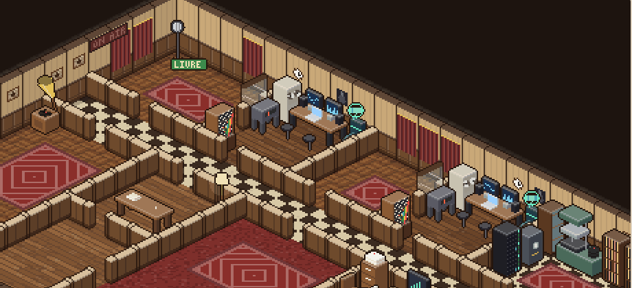
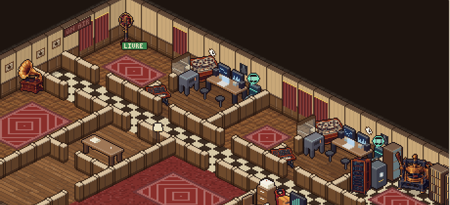
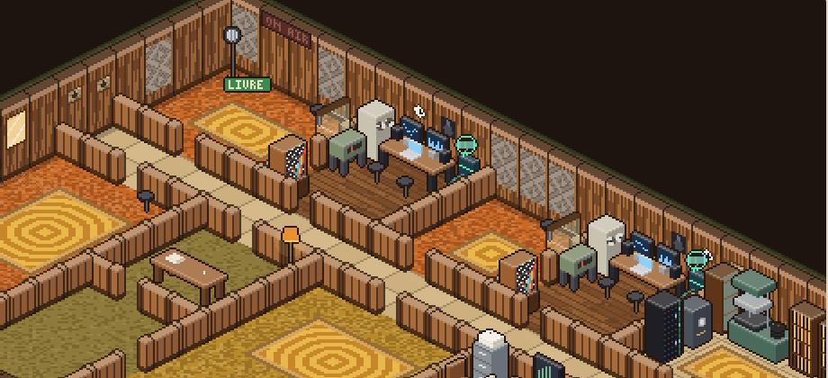
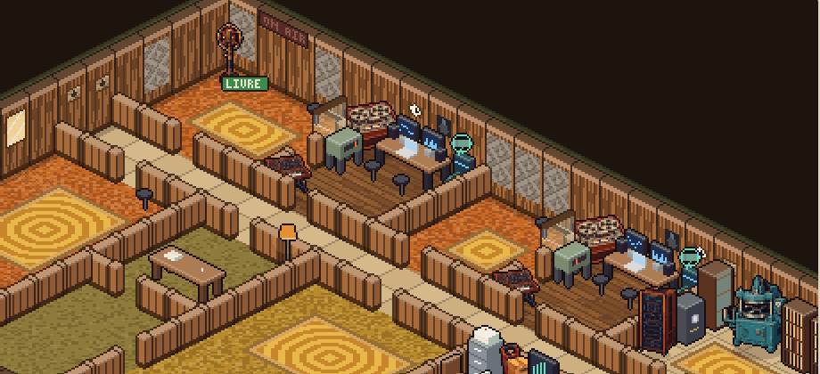
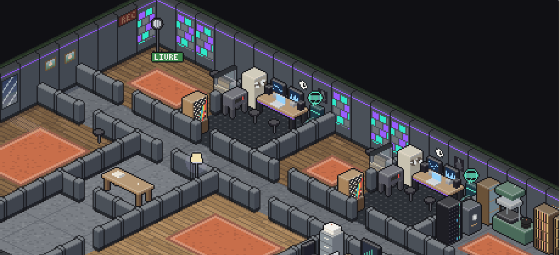
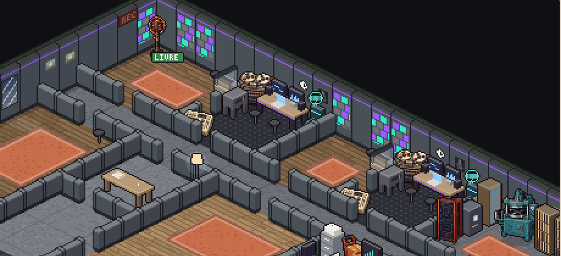

# Arte dos objetos e equipamentos — alinhamento ao pacote v1

Branch `claude/arte-objetos`. Referência: `art/pack-equipamentos-v1/` (29 PNGs de ~1250 px) e as regras de estilo da
skill `masters-artist-sprites` (rampas de 6 tons com sombra arroxeada e luz quente, luz de cima à esquerda, contorno
`#170e12`, mogno/latão/vinho/cromado).

## Como os objetos apareciam

- **Sede (HqView, `src/ui/hq.ts`)** e **lugares** (`places/*`): todos os móveis e equipamentos vêm de
  `furniture(kind, era, facing, variant, frame)` em `src/ui/pixel/sprites.ts`, que desenha caixas isométricas
  procedurais. Tamanho lógico: 16–48 px de largura (1 tile = losango de 32 px; 2×1 = 48 px) e 12–40 px de altura,
  ampliados por zoom inteiro (2×–5×) num backbuffer sem suavização.
- **Equipamento do jogador**: `equipmentVisual(id, era)` (mesmo arquivo) leva cada item de `EQUIPMENT` a um tipo de
  móvel e a uma sala.
- **Loja de equipamentos** (`equipmentSection20`, `src/ui/panels/misc.ts`): só texto, sem imagem.

## Decisão: pacote reduzido (a) onde há asset + procedural com acabamento da casa (b) no resto

Escolhi **(a) os PNGs do pacote reduzidos com um redutor próprio para pixel art**, combinado com o procedural para o
que o pacote não tem:

- **Fidelidade ao estilo.** O pacote *é* a referência; redesenhar 25 objetos à mão em código (b) daria só uma
  aproximação, com muito mais código. No teste a 30–40 px a redução preserva silhueta, contorno, latão brilhante e
  os detalhes que importam (rolos do gravador, VUs da mesa, pratos da bateria).
- **Peso.** Um atlas indexado único de **192×161 px, ~14 KB** (`src/assets/gear21.png`) cobre os 25 sprites. É uma
  requisição só, carregada antes da primeira cena (`gearReady()` em `src/main.ts`, com limite de 3 s; se falhar,
  tudo continua procedural).
- **Redução sem borrão** (`tools/gear-pack.py`): recorte pela máscara alfa → média de área em dois passos sobre
  alfa pré-multiplicado (4× o alvo, nitidez leve, alvo) → alfa binário → +saturação/contraste leves → quantização
  sem pontilhado (≤ 22 cores por sprite, o que reconstrói rampas de tons) → contorno externo de 1 px `#170e12` →
  paleta global ≤ 256 cores. O tamanho de cada sprite sai da pegada do objeto (largura máx.) e da altura de `FURN`.
- **Orientação.** O pacote é 3/4 virado para a esquerda, compatível com a orientação SW; em SE o sprite é espelhado.
  As peças do pacote não trazem chão, então ganham uma sombra de contato suave.
- **O que fica procedural** (sofás, mesas, cadeiras, estantes, plantas, cofre, câmara de eco, painéis, ônibus,
  equipamentos de 2030 com holografia…): recebe o acabamento da casa em `make()` — contorno `#170e12` no lugar do
  contorno da paleta da era e uma graduação que puxa os tons escuros para a sombra arroxeada e os claros para a luz
  quente das rampas do pacote (`gearFinish`). Os tons médios, que carregam a cor do material, não mudam.
- **Fonógrafo 1890 (01, corrompido no pacote).** Desenhado no script com o motor de estilo da skill (`px.py`: caixa
  de mogno, cilindro de cera, corneta e manivela de latão) e reduzido pelo mesmo caminho. Aparece no lugar do
  gramofone quando o ano mostrado é anterior a 1910 (`setGearYear`, chamado no `sync` da sede).
- **Animação.** Os sprites do pacote são estáticos: o gramofone, o gravador e a prensa deixam de girar/bater na sede
  (o procedural tinha 2–4 quadros). Troquei movimento por legibilidade; dá para devolver com um brilho girando
  desenhado por cima, se fizer falta.

## Mapa objeto/era → asset (`gearFor` em `src/ui/pixel/gear21.ts`)

| Tipo (`FurnKind`) | Onde aparece | Asset por era |
|---|---|---|
| `gramophone` | sede (sala/escrita), salas e casas | ano < 1910: **fonógrafo** (desenhado); depois: 02 gramofone |
| `mic` | cabine, palcos | variante 1 (microfone de fita) e eras ≤ 1960: 03 microfone 1930; depois: procedural |
| `tape` | sala de controle | ≤ 1960s/70s: 04 gravador 1950; 1980+: 06 multifaixas |
| `console` | sala de controle, palcos | 05 mesa 1960 |
| `daw` | sala de controle (console digital) | 07 DAW 2000 |
| `server` | arquivo digital | 09 servidor 2035 |
| `piano` | ensaio, salas | 10 piano |
| `drumkit` | ensaio, palcos | 14 bateria |
| `synth` | ensaio | até 1990s: 15 sintetizador; 2000+: 17 DJ |
| `synth_rack` | sala de controle (rack de sintetizadores) | até 1980s: 15 (menor); 1990+: 16 sampler |
| `amp` | ensaio, palcos | 18 amplificador + instrumento ao lado: 11 violão (≤ 1950s), 12 guitarra (variante par) ou 13 baixo (ímpar) |
| `speaker` | ensaio, palcos | 1960–2020: 20 caixa PA; 1920/50 e 2030: procedural |
| `press` | fábrica própria, fábrica (lugar) | ≤ 1950s: 23 prensa 1930; 1960–80s e 2010+: 24 prensa 1970; 1990–2000s: 26 duplicador de CD |
| `crate` | depósito, equipamento desconhecido | 1920: 29 cilindros; depois: 27 caixa de discos |
| `mailbag` | mala direta e fã-clube | 28 carrinho de estoque |

Equipamentos do jogador (via `equipmentVisual`): microfone de fita → 03; mesa de som → 05 (07 a partir de 1990);
gravador multipista → 04/06; rack de sintetizadores → 15/16; console digital → 07; fábrica própria → 23/24/26;
mala direta → 28; arquivo digital → 09. Câmara de eco, plugins, IA, contrato de prensagem, ilha de vídeo, painel,
sala de descanso, ônibus e cofre seguem procedurais com o acabamento da casa (não há objeto equivalente no pacote).

**Assets do pacote sem uso no jogo hoje:** 08 interface 2020, 19 monitor de palco, 21/22 refletores, 25 duplicador
de cassete e 30 disco 78. Não existem objetos correspondentes nas cenas (a disposição é de `scene.ts`/`places/*`,
fora deste escopo); ficam fora do atlas para não pesar. Para usar, basta incluir a linha em `SPRITES` do script e
um caso em `gearFor`.

## Loja de equipamentos

`equipmentSection20` ganhou uma coluna com a miniatura do item na era atual: o mesmo sprite da sede
(`equipmentThumb` em `sprites.ts`), recortado e ampliado por fator inteiro (pixels nítidos).

## Arquivos

- `tools/gear-pack.py` — gera `src/assets/gear21.png` e `src/ui/pixel/gear21-atlas.ts` (`python3 tools/gear-pack.py`,
  Pillow + numpy).
- `src/ui/pixel/gear21.ts` — carga do atlas, mapa `gearFor`, desenho com espelho, dica de ano.
- `src/ui/pixel/sprites.ts` — `furniture()` usa o pacote quando há asset; `gearFinish` + contorno da casa no
  procedural; `equipmentThumb`.
- `src/main.ts` (pré-carga), `src/ui/hq.ts` (ano + redesenho quando o atlas chega), `src/ui/panels/misc.ts` e
  `src/styles.css` (miniaturas na loja).
- `tools/preview/gear.html` — prévia de desenvolvimento (fora do build): `npm run dev` →
  `/tools/preview/gear.html?year=1965` (sede com todo o equipamento), `?view=gallery`, `?view=shop&year=…`,
  `&pack=0` desliga o pacote.

Regras de simulação e saves não mudaram; sprites de artistas não foram integrados.

## Screenshots (Playwright + Chromium, zoom 2×)

Antes = commit base; depois = esta branch.

| Era | Antes | Depois |
|---|---|---|
| 1925 |  |  |
| 1965 |  |  |
| 2025 |  |  |

Fonógrafo antes de 1910: 

Galeria de todos os objetos (3×):
[1920/1960 antes](arte-objetos/galeria-1920-1960-antes.png) ·
[1920/1960 depois](arte-objetos/galeria-1920-1960-depois.png) ·
[2000/2030 antes](arte-objetos/galeria-2000-2030-antes.png) ·
[2000/2030 depois](arte-objetos/galeria-2000-2030-depois.png)

Loja: [1925](arte-objetos/loja-1925-depois.png) · [2025](arte-objetos/loja-2025-depois.png)

## Peso do build

Atlas: 13,7 KB (PNG indexado). Código novo: ~6 KB não minificado. Os PNGs originais do pacote ficam só em `art/`
(não entram no build).
