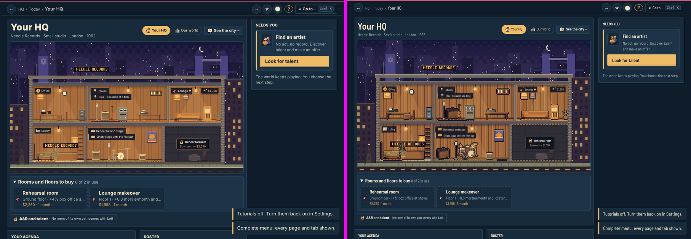
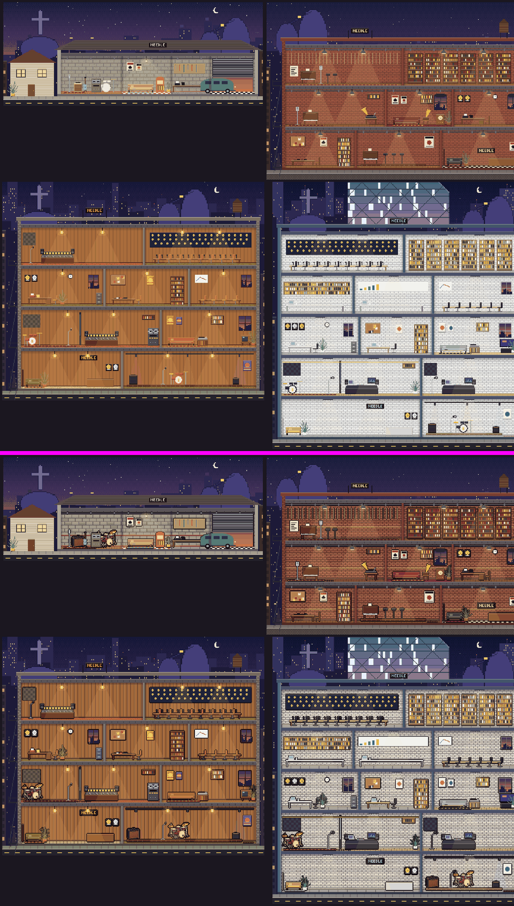
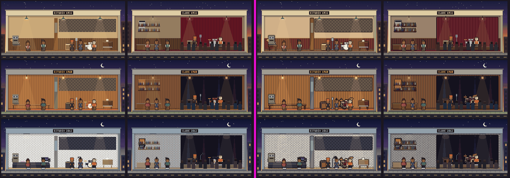
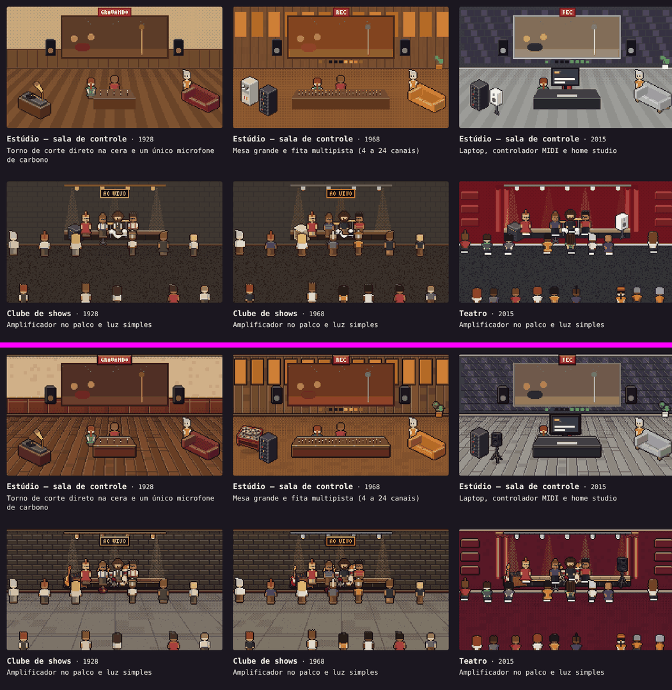
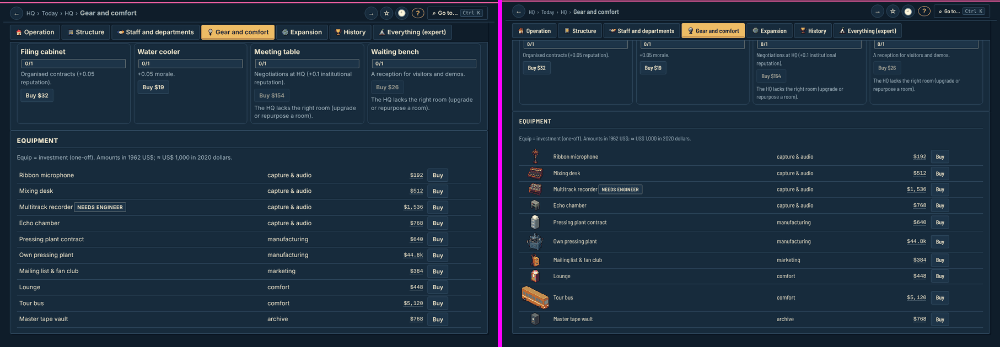
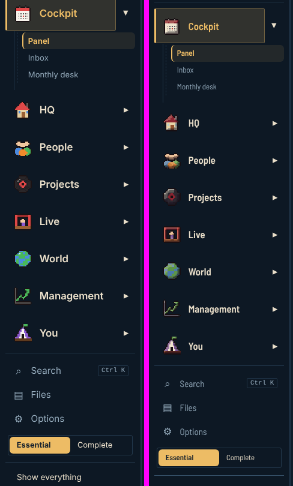
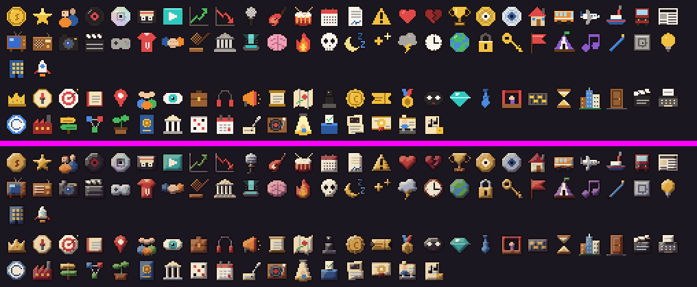
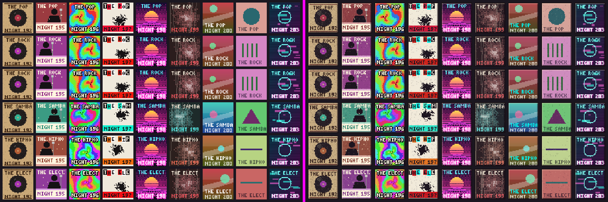
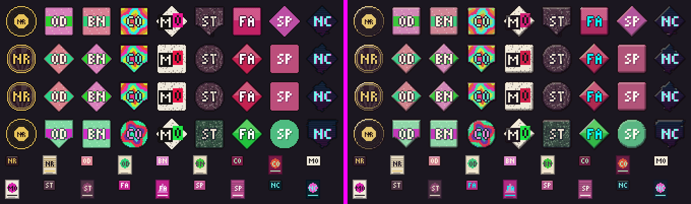

# Arte r27 — port do estilo oficial para o código atual

Port das três sessões de arte que partiram da base antiga (`8cbf726`, rodada 20) para a rodada 27
(`claude/friendly-brown-vpsmfl` @ `458231c`). Referências: `.claude/skills/masters-artist-sprites/SKILL.md`,
`art/pack-equipamentos-v1/`, `docs/arte-artistas/`. Nenhuma regra de simulação, save, texto ou ID exportado mudou;
`shade()` e as assinaturas antigas continuam iguais. Tudo segue determinístico e com as variações de época/dia/noite.

Branches de origem (cada uma com seu doc, que continua valendo para as decisões de estilo):

| branch | doc original | status |
| --- | --- | --- |
| `claude/arte-ambientes` | `docs/arte-ambientes.md` | portado + **adaptado** à sede em corte (`hqpx27`) e aos interiores (`interior27`) |
| `claude/arte-objetos` | `docs/arte-objetos.md` | portado (atlas `gear21`) + **usado também** na sede em corte e nos interiores |
| `claude/arte-icones` | `docs/arte-icones.md` | portado + **ajuste** de legibilidade para o menu escuro do ui27 |
| `claude/arte-cenas` | — | **não portado** (pedido: o horizonte/marcos e `campus18px`/`city27` estão sendo refeitos em outra sessão) |

## 1. O que foi portado direto

Os arquivos abaixo não mudaram entre `8cbf726` e a r27, então a diferença das branches entrou como estava
(`git diff 8cbf726 origin/claude/<branch>` aplicado com 3-way):

- **`src/ui/pixel/px.ts`** — utilitários do estilo: `INK` (`#170e12`), `HOUSE` (mogno/latão/vinho/cromado), `ramp6`, `lv`,
  `tint` (como `shade`, mas andando pela rampa: sombra arroxeada, luz quente), `volume`/`discV`/`ellipseV`/`rectV`,
  `inked`, `glint`; `Px.sbox` usa a rampa. `shade()` intacto.
- **`src/ui/pixel/palette.ts`** — paletas por era: contorno único `INK`, madeira puxando para o mogno, latão/cromado,
  2010 sem branco puro, 2000/1980 menos saturados; `rampOf`, `HOUSE_COLORS`, `INK` exportados.
- **`src/ui/pixel/tiles.ts`, `src/ui/hq.ts`** — pisos/paredes/luz da planta isométrica antiga. Observação: desde a r27 (D1)
  a `HqView` isométrica não aparece mais na tela da Sede; ficou portado por consistência (o arquivo ainda exporta
  `hqHooks` e tipos usados por outros módulos).
- **`src/ui/pixel/places/{kit,rooms,rooms14,venues}.ts`** — cenas de estúdio, palco, teatro, festival etc. (usadas pelas
  cenas `scene14`, momentos e cinemáticas): parede com sanca/rodapé, piso sem ruído, móveis contornados, cortina em 6 tons.
- **`src/ui/pixel/sprites.ts`, `src/ui/pixel/gear21.ts`, `src/ui/pixel/gear21-atlas.ts`, `src/assets/gear21.png`** —
  atlas de 25 equipamentos do pacote (13,7 KB, PNG indexado), `gearFor`, acabamento da casa no procedural,
  `equipmentThumb`. `tools/gear-pack.py` (gerador) e `tools/preview/gear.*` (prévia de dev) vieram juntos.
- **`src/ui/art.ts`, `src/ui/pixel/icons.ts`, `src/ui/pixel/icons17.ts`, `src/ui/pixel/finish.ts`, `src/ui/pixel/iconkit.ts`** —
  ícones, capas, logos, crachás e cartazes com relevo, gradação quente e contorno `INK`; `tools/artsheet/` (folha de dev).

## 2. O que foi adaptado aos arquivos novos

- **Conflitos resolvidos à mão**: `src/main.ts` (a r27 ganhou fontes e instaladores; o boot agora espera `gearReady()`,
  com limite de 3 s, como a branch de objetos pedia), `src/ui/hq.ts` (imports das duas branches) e
  `src/ui/panels/misc.ts` (a r27 trocou `HqView` por `hqPeek27`; mantidos os dois imports novos da loja).
- **`finish.ts` usa a rampa de `px.ts`**: a branch de ícones tinha uma cópia própria de `ramp6`/`INK`/`HOUSE` (o doc dela
  pedia para trocar quando os utilitários de `px.ts` existissem). Agora é uma fonte só; `HOUSE` de `finish.ts` virou um
  apelido com os nomes em português.
- **Sede em corte (`src/ui/ps/hqpx27.ts`)** — o desenho atual da "Sua sede" (e da Home e da prévia), que não existia na base.
  Mesma intenção da branch de ambientes:
  - `shade` → `tint` em todo o arquivo (sombras arroxeadas, luzes quentes); contorno local `#16121c` → `INK` da casa;
  - `blk` (a caixa base de quase toda a mobília) com luz em cima e na esquerda (tons 4/3,5), pé em sombra (tom 1) e lado
    direito em meia-sombra (tom 2);
  - mobília, pôsteres, discos de ouro e a reforma do lounge pintados numa **camada própria contornada com `INK`**
    (o truque do `inked()`: o fundo é opaco e o contorno do `Px` só enxerga o vazio). Uma passada de contorno por pintura;
  - parede sem ruído "sal e pimenta": tijolo/bloco com junta (tom 1) e fio de luz por fiada, cor por peça; ripas com chanfro;
    lambri com veio e régua (latão até 1940); oclusão em degraus arroxeados sob a sanca, sobre o rodapé e nos cantos;
    rodapé saliente; piso em tábuas com junta e fio de luz, ladrilho, trama de carpete e placas de concreto;
  - **equipamentos do pacote** onde a escala casa com os bonecos de 34 px: bateria (a partir de 1940) e amplificador grande
    (a partir de 1950). Para isso `gear21.ts` ganhou `gearPx(id)` (o mesmo atlas decodificado uma vez para `Px`).
    Sem atlas (testes, sem DOM, falha de rede) o desenho continua o procedural de antes. Ficaram procedurais o piano
    (o do pacote é de cauda e 36 px de altura, maior que uma pessoa), o gramofone/fonógrafo (36 px) e a mesa/DAW
    (o corte lateral já tem mesa com monitores e telas por geração).
- **Interiores da cidade (`src/ui/pixel/interior27.ts`)** — usa as primitivas da sede (`prim27`), então herdou tudo acima;
  além disso: `shade` → `tint`, adereços numa camada contornada, pregas da cortina do palco em 3 tons da rampa,
  oclusão arroxeada nos cantos, faixa de luz da prateleira de garrafas mais fraca (não ganha contorno).
- **Ícones no menu escuro do ui27**: com o relevo "por região" da branch, em 16 px quase todo pixel vira borda e os ícones
  escuros (disco, globo) sumiam no fundo azul-noite. `relief()` ganhou `bias` e `minTone` (opcionais, padrão = antes) e
  `finishIcon` passou a usar o modo silhueta (o ícone inteiro é um volume), luz um pouco mais alta e sem o tom 0.
  Logos e capas não mudaram em relação à branch.

## 3. O que ficou de fora e por quê

- **`claude/arte-cenas`** inteira (`campus18px.ts`, `city27`, `landmarks19px.ts`, `cine18.ts`, `cenas20.ts`, `map.ts`): pedido
  explícito — outra sessão está refazendo o horizonte e os marcos (`lmiso27.ts`). O céu e o horizonte da sede em corte
  (`sky`/`skyline`/`landmarks27`) também ficaram como estavam pelo mesmo motivo.
- **Screenshots e PNGs antigos dos docs das branches** (`docs/arte-ambientes/`, `docs/arte-objetos/`, `docs/arte-icones/`):
  mostram a rodada 20; não entraram para não pesar o repositório. Os `.md` continuam nas branches.
- **Paleta de `city27`/`campus18px`**: não foi tocada aqui, mas eles leem `paletteOf()`; o contorno `INK` e as cores novas da
  era chegam lá automaticamente (sem mudança de forma).

## 4. Desempenho e tamanho

- Atlas: 13,7 KB (único asset novo do build). `gearPx` decodifica o atlas uma vez e guarda cada sprite.
- Sede/interior: uma camada extra do tamanho do quadro e uma passada de `outline` por pintura (O(largura × altura),
  ~0,2 Mpx) — a pintura já percorria todos os pixels da parede.
- Rampa (`ramp6`) com cache por cor.

## 5. Testes

- `NODE_OPTIONS=--max-old-space-size=6144 npx tsc --noEmit -p .`: sem erros.
- Testes ligados a pixel/arte/sede/lugares/ícones/navegação/ui (34 arquivos achados por grep, em lotes de 6):
  33 arquivos e 310 testes passam. `tests/r16-menus.test.ts` não carrega (`ReferenceError: Cannot access 'LOAD_EXTRA'
  before initialization`, ciclo de import em `sim/sys/careers12.ts` ↔ `manager12.ts`) — falha igual na base `458231c`,
  sem relação com a arte. Nenhum teste foi alterado (nenhum fixa pixels ou paletas tocados aqui).

## 6. Screenshots (Playwright + Chromium)

Antes = `claude/friendly-brown-vpsmfl` (worktree em `458231c`), depois = esta branch. Partida com `Math.random` semeado
(mesma run nos dois), "NEW RUN" → "START MY STORY", 1440×900. O harness desenha os módulos direto
(`drawHqCutaway27`, `drawInterior27`, `scene14`, `coverUrl`, `logoUrl`, `badgePx`, `posterPx`, `iconUrl`, `icon17`).
Obs.: no "antes" a fonte da UI cai no fallback (o worktree usa um `node_modules` linkado de fora da raiz do vite);
compare só a pixel art.

| tela | arquivo |
| --- | --- |
| Sede › Sua sede (jogo) | `arte-port27/sede-antes-depois.png` |
| Sede em corte: garagem 1955, loft 1928, prédio 1972, torre 2018 | `arte-port27/hq-cutaway-antes-depois.png` |
| Interiores da cidade: estúdio e casa de shows em 1932, 1968, 2012 | `arte-port27/interiors-antes-depois.png` |
| Cenas: técnica do estúdio e clube/teatro em 1928, 1968, 2015 | `arte-port27/scenes-antes-depois.png` |
| Loja de equipamentos (Sede › Equipamentos e conforto) | `arte-port27/loja-antes-depois.png` |
| Ícones do menu principal (jogo) | `arte-port27/menu-antes-depois.png` |
| Todos os ícones (`ICON_NAMES` + `ICON17_NAMES`, 2×) | `arte-port27/icons-antes-depois.png` |
| Capas: 6 gêneros × 9 épocas | `arte-port27/covers-antes-depois.png` |
| Logos de selos, crachás e cartazes | `arte-port27/logos-antes-depois.png` |

Uma partida nova não tem lançamentos nem logos de rivais na tela de selo, por isso capas e logos foram conferidos no harness.

## 7. Próximos passos sugeridos

- Portar `claude/arte-cenas` quando o horizonte/marcos novos (`lmiso27`) estiverem na branch principal.
- Céu e horizonte da sede em corte: alinhar à rampa junto com o trabalho de cenas.
- Miniaturas da loja: o ônibus sai bem maior que os outros itens (fator inteiro sobre um sprite largo); dá para limitar a altura.
