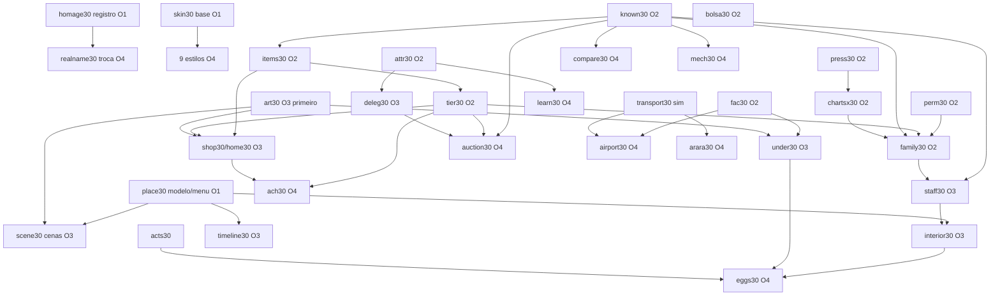

> **Decisão do autor (posterior a este mapa):** não há evento de chegada em 1975 nem fase em Cantù. A família está sempre presente na cidade, em qualquer ano, em lugares e papéis que fazem sentido para a época. Ignore as menções à chegada abaixo.

# Masters 31 — mapa de sistemas (o que é novo, onde encaixa, em que ordem)

Documento de apoio ao plano R31 (`index.html`) e ao plano de navegação (`plano-telas.md`). Só leitura: nada foi
alterado no repositório. Todos os caminhos de arquivo foram conferidos no código (ramo `claude/friendly-brown-vpsmfl`,
commit `495c2c2`).

Como ler: **sistema novo** = código que ainda não existe. **Encaixa em** = sistemas que já existem e que ele lê ou
altera. **Lê / Escreve** = para onde vão os dados. **Riscos** = o que pode quebrar.

Palavras técnicas usadas (uma vez só):
- **Goldens** = testes de referência que guardam números exatos de uma partida simulada (`tests/sim.test.ts`,
  `tests/r27-p2a.test.ts`, `tests/r27-p2b.test.ts`). Qualquer mudança na simulação muda esses números e eles precisam
  ser "remedidos" na junção da onda.
- **Determinismo** = a mesma semente dá sempre a mesma partida. Todo sorteio novo usa um gerador próprio
  (`Rng.fromSeed('semente|chave|semana')` ou um fluxo novo em `src/sim/rng19.ts` → `STREAMS19`), nunca o fluxo comum.
- **Migração de save** = saves antigos precisam abrir. Estado novo vai em `s.x4` via `registerExt4` (`src/sim/ext4.ts`),
  com valor inicial vazio; `SAVE_VERSION` (6, em `src/sim/worldgen.ts`) só sobe se o formato antigo mudar de sentido.
- **Interruptor** = chave que liga/desliga a ligação na medição; padrão do projeto é `CONN29.off`
  (`src/sim/sys/conn29.ts`, variável de ambiente `CONN29_OFF`).
- **Fato** = acontecimento publicado no barramento `emitFact`/`onFact` (`src/sim/facts17.ts`); é a forma barata de
  um sistema novo reagir aos antigos sem editar os arquivos deles.

---

## 1. Lista dos sistemas novos

Agentes e ondas são os do plano (A–Y). **Z** é um agente novo proposto aqui para as homenagens à família
(itens aprovados depois do plano). Marcado com ⚠ quando proponho mudar a onda.

| # | Sistema novo (nome de código) | O que é, em uma linha | Onda · agente |
|---|---|---|---|
| 1 | `place30` (modelo de lugares) | Tabela única "página antiga → entrada › lugar" + pendências por lugar (`pending30`) + menu de ≤10 itens (`menu30`) | O1 · A |
| 2 | `ask30` (painéis em vez de janelas do navegador) | Substitui ~40 `confirm/prompt/alert` por painéis do jogo; teste proíbe janela do navegador | O1 · B |
| 3 | `skin30` (estilos por época) | Tokens de interface por década (9 estilos + o de hoje), troca automática, contraste e daltonismo | O1 · C (base) / O4 · M (9 estilos) |
| 4 | `homage30` (registro de nomes de terceiros) ⚠ | Lista única "nome real → homenagem" + teste de varredura; a troca na tela vem depois | **esqueleto em O1 · A**; troca na tela O4 · X |
| 5 | `press30` (pressão de mercado) | Tira a penalização pós-1990 só do jogador e põe uma pressão igual para todos, visível na autópsia | O2 · D |
| 6 | `bolsa30` (fundamentos do seu selo) | Preço da sua ação segue o valor da empresa e reage aos mesmos eventos dos rivais, com motivo nas notícias | O2 · E |
| 7 | `known30` (conhecidos) | Estado de relação Desconhecido › Conhecido › Colega › Amigo › Melhor amigo / Desafeto › Rival › Inimigo, e como se conheceram | O2 · F |
| 8 | `attr30` (etiqueta de resultados) | Cada entrada/saída de dinheiro ganha artista/projeto; o resto fica "não alocado"; diário guarda o contexto da hora | O2 · P |
| 9 | `fac30` (facções por país + intermediário) | Completa facções por país com época, presença só no país da sede, contratação de fora pelo intermediário | O2 · U |
| 10 | `chartsx30` (paradas por país) | Fama local vende, peso da língua, leis no país certo, dominó, fama menos uniforme, cota do artista local | O2 · Y |
| 11 | `items30` (objetos com história) | Todo bem comprado vira objeto com dono, lista de donos e três formas de compra (você / empresa / presente) | O2 · G |
| 12 | `tier30` (níveis de relíquia por pontos) | Cinco níveis (Comum…Mítica) pela soma de pontos de história; sem "próximo nível" | O2 · G |
| 13 | `perm30` (pessoas permanentes) | Marca de "NPC permanente": não envelhece, não morre, não some — usada pela família | **O2 · Z** (novo) |
| 14 | `family30` (homenagem à família Fossati) | Família sempre presente; Metalmac; clube de tênis; aeroclube; almoço da Lucia; Sonia; Antonella; violino do Efro; papéis adaptados à época (sem evento de chegada) | **O2 · Z** (sim) / O3 · H-I (lugares) / O4 · N (notícias e ovos) |
| 15 | `shop30` (loja e estoque do mês) | Loja de instrumentos interativa; estoque muda por mês e época; vitrine de relíquia com chance por nível | O3 · H |
| 16 | `home30` (sua casa por dentro + garagens) | Interior da casa por tipo/época, itens nas prateleiras, carros na garagem da casa e da sede | O3 · H |
| 17 | `lots30` (lojas que abrem e fecham) | Cada terreno troca de negócio por época; mapa maior só acrescentando lotes | O3 · H |
| 18 | `staff30` (gente de verdade nos lugares) | Dono ≠ funcionários; equipe com bico de músico; troca quando alguém assina; presença segue a agenda | O3 · I |
| 19 | `interior30` (12 interiores sempre interativos) | Objetos clicáveis, ações por lugar, época, seu rastro, gestão quando o lugar é seu | O3 · I |
| 20 | `scene30` (cenas da sede) | Mesa do chefe, Turnê, Projeto, Estúdio, Talentos, Troféus; cabeçalhos clicáveis | O3 · J, K |
| 21 | `timeline30` (linha do tempo única) | Junta calendário, agenda, rollouts, turnês, contratos, dívidas e vida em faixas, de semana a década | O3 · J |
| 22 | `deleg30` (diretrizes + registro de automação) | Diretrizes para chefe de A&R e produtor executivo; um registro só de "quem agiu, por qual diretriz, quanto gastou, resultado"; visão agregada do elenco | O3 · Q |
| 23 | `under30` (submundo no mundo) | Fachadas, salas dos fundos, mural de ligações, delegacia, mercado negro, baile | O3 · S |
| 24 | `neon30` (neon e outdoors das paradas) | Neon por época; outdoors mostram os nº 1 de cada parada do seu país; outdoor pago | O3 · L (arte) + H (dados) |
| 25 | `art30` (arte nova) | Peças de pixel: pedestais dos 5 níveis, fachadas por época, aeroporto, leilão, veículos em perspectiva | O3 · L |
| 26 | `compare30` (comparar com névoa) | Comparar qualquer artista conhecido; o que você não sabe aparece "?" com link ao olheiro | O4 · N |
| 27 | `ach30` (conquistas visíveis e secretas) | Bloqueadas aparecem com nome e como ganhar; secretas seguem "???"; conquistas novas | O4 · N |
| 28 | `eggs30` (pacotes de ovos de páscoa) | Edison, bandas de ficção, cultura pop (Breaking Bad, Sopranos…), filme do jogador, família | O4 · N |
| 29 | `acts30` (artistas que faltam) | Bandas de filmes/séries + artistas brasileiros de TV e infantis que faltam | ⚠ **O2 · Z ou N antecipado** (muda o mundo gerado) |
| 30 | `learn30` (resultados e aprendizados) | Tela por projeto e por coorte; biblioteca de aprendizados rotulada como correlação | O4 · R |
| 31 | `transport30` (escolha de transporte) | Cada trecho mostra navio/trem/avião da época; cruzeiros; holograma; notícias da aviação | ⚠ **sim em O2** (T), cena em O4 · T |
| 32 | `airport30` (aeroporto por época) | Partidas, desembarque, alfândega, sala VIP (intermediário), hangar | O4 · T |
| 33 | `auction30` (motor de leilão em cena) | Leiloeiro, plateia real com pistas, lances por rodada, representante com teto, consignação, envelope | O4 · T |
| 34 | `arara30` (agência Arara Trips) | Agência de viagens na cidade: vende pacotes de transporte, cruzeiro e voo do aeroclube | O4 · T (junto da escolha de transporte) |
| 35 | `mech30` (mecânicas em cena) | Moldura única de "mesa de negociação": cláusulas como papéis, paciência, pistas, pular cena | O4 · V, W |
| 36 | `rn30` (regras RN) | Motivo do bloqueio antes do clique; estimado/reservado/a pagar; favoritos; metas pessoais; fato/cálculo/hipótese | O4 · O |
| 37 | `realname30` (troca na tela) | Interruptor único "Nomes e obras reais" aplicado a textos, fichas, cenas e logotipos | O4 · X (último) |

---

## 2. Onde cada sistema encaixa no que já existe

Formato: **Encaixa em** (arquivos) · **Lê** · **Escreve** · **Riscos**.

### 2.1 Estrutura (Onda 1)

**`place30` / `menu30` / `pending30`** (novos em `src/ui/ps/`)
- Encaixa em: `src/ui/ps/hq25model.ts` (salas da sede), `src/sim/sys/hqrooms27.ts`, `src/sim/sys/campus18.ts`
  (prédios seus), `src/sim/sys/place27.ts` (lugares do bairro, tipo `PlaceK27` na linha 32), `src/ui/ps/tree27.ts`,
  `src/ui/ps/view27.ts`, `src/ui/ps/search25.ts`, `src/ui/ps/tabsreg27.ts`, `src/ui/route16.ts`,
  `src/sim/inbox18.ts` (itens que pedem decisão), `src/ui/ps/alerts29model.ts`, `src/sim/calendar19.ts`
  (`registerDeadline`, prazos).
- Lê: badges registrados (`registerArea/registerTab`), caixa de entrada, alertas, prazos. Escreve: nada na simulação.
- Riscos: só interface; quebra ~15 testes de navegação (lista em `plano-telas.md` §9). Nenhum golden.

**`ask30`** — encaixa em `src/ui/dom.ts`/`src/ui/common.ts` (componentes), `src/ui/saves17.ts`, `src/ui/newgame*.ts`,
`src/ui/sys/kin27.ts`, `src/ui/sys/biz17.ts` (usam `confirm`). Risco: `confirm` é síncrono e o painel é assíncrono →
todo chamador vira "callback"; erro comum é a ação rodar antes da resposta.

**`skin30` base** — encaixa em `src/ui/store.ts` (linha 99 já define `data-theme`), `src/ui/ps/theme25.css`,
`src/styles.css`. Lê `s.year` só para escolher o estilo. Risco: contraste; nenhum golden.

**`homage30` esqueleto** ⚠ — encaixa em `src/data/realnames.ts` (hoje só cobre a rodada 6). Precisa existir desde a
O1 porque o briefing manda **todo agente** registrar nome real novo com homenagem; se o arquivo só nascer na O4, os
agentes das ondas 2–3 não têm onde registrar.

### 2.2 Simulação (Onda 2)

**`press30` (pressão de mercado no lugar de `commod`)**
- Encaixa em: `src/sim/market.ts` → `computeAppeal` (linhas 124–128: `commod` = −0,75/ano desde 1990, teto 15, só
  para o jogador e a banda do jogador); previsão de vendas (`src/sim/sys/explain12.ts`, `src/sim/sys/odds19.ts`);
  autópsia (fatores `AutopsyFactor` do próprio `computeAppeal`); `src/sim/sys/caps18.ts` (família de causa).
- Lê: ano, qualidade. Escreve: apelo de **todos** os lançamentos (mudança grande).
- Riscos: muda todos os goldens; mexe no equilíbrio de começar tarde (meta ~3× começar em 1990). Interruptor obrigatório.

**`bolsa30` (fundamentos)**
- Encaixa em: `src/sim/business.ts` linhas 257–258 (passeio aleatório do preço do seu selo — origem do "escorrega todo
  começo de ano"), `src/sim/sys/bolsa10.ts` (rivais já usam valor real; `OWN` na linha 684/791), `src/sim/sys/capital.ts`
  (avaliação, linha 135; IPO, linha 406; dividendos), `src/sim/sys/aud27/macro27.ts` (juros), `src/sim/sys/scenes/board.ts`.
- Lê: catálogo, elenco, caixa, dívida (`src/sim/oblig20.ts`), fatos (escândalo, processo, relíquia, prêmio, antitruste,
  boicote, cancelamento, saída de funcionário-chave). Escreve: `s.listing.price/history`, notícias da bolsa.
- Riscos: golden (o passeio usa o fluxo comum `r.normal` — trocar a conta muda a ordem dos sorteios); controle do
  selo (`controlShare`) e demissão pelo conselho dependem do preço.

**`known30` (conhecidos)**
- Encaixa em: `src/sim/sys/persona13.ts` → `opinionOf`/`opine` (linhas 496–520; a opinião hoje mora em 5 lugares:
  líderes `l:`, críticos `c:`, equipe `s:`, pessoas `p:` via `Person.rel`, e o resto em `p13().op`);
  `src/sim/sys/social8.ts` (laços entre NPCs, `bump`, `tieOf`); `src/sim/sys/bonds9.ts`; `src/sim/sys/favors27.ts`;
  `src/sim/holds17.ts` (favores, promessas, mágoas); `src/sim/sys/promises28.ts`; névoa do olheiro
  (`src/sim/sys/discover18.ts`, `src/sim/sys/ability18.ts`); `src/ui/sys/knownacts27.ts`.
- Lê: contratações, gravações, shows, festivais, premiações, visitas, imprensa (por fatos). Escreve: estado novo
  `s.x4.known30[chave] = { nível, desde, como, último contato }`; **não** altera os 5 valores de opinião existentes.
- Riscos: migração — saves antigos: quem tem opinião ≠ 0 vira "Conhecido" (cuidado: `Person.rel` pode já ter muitas
  entradas do início do jogo → muita gente "conhecida"); esfriar com o tempo é tique mensal → golden se mexer em
  opinião. Regra do plano: ninguém muda de estado sem ação → golden estável.

**`attr30` (etiquetas de resultado)**
- Encaixa em: `src/sim/util.ts` → `post()` (linha 59; **1049 chamadas** de `post(s` e 379 de `pay(s` no simulador),
  `src/sim/ledger18.ts` (`book18`, seções da DRE), `src/sim/oblig20.ts`, `src/sim/sys/fin20.ts`, diário
  (`src/sim/sys/story28.ts`, ecos `src/sim/sys/echoes18.ts`/`echoes19.ts`).
- Lê: chave do lançamento contábil. Escreve: etiqueta artista/projeto por lançamento (anel próprio, não o `s.ledger`
  de 400 linhas), contexto do diário (caixa, fama, chance mostrada).
- Riscos: **conflito de arquivos** — se mudar a assinatura de `post()`, todos os agentes da onda conflitam. Proposta:
  não mudar a assinatura; deduzir a etiqueta da `key` (já traz ids na maioria) e oferecer um "contexto atual"
  (`withAttr30(s, {act, proj}, fn)`) para os casos ambíguos. Golden: não muda se só guardar etiqueta.

**`fac30` (facções por país + intermediário)**
- Encaixa em: `src/data/orgs17.ts` (15 organizações) + organizações digitais/inventadas de `aff29`
  (`STREET29`), `src/sim/sys/crime17.ts` (organizações, `registerPer13('o', …)`), `src/sim/sys/mob29.ts` ("contratar a
  família", favor devido), `src/sim/sys/aff29.ts` / `aff29npc.ts` (facção × gênero × artista),
  `src/sim/sys/orglinks29.ts`, `src/sim/sys/crimetargets29.ts`, `src/sim/sys/crimemem23.ts`, `src/sim/holds17.ts`.
- Escreve: novas organizações com época; taxa e risco do intermediário; "expansão" da facção de fora.
- Riscos: golden (novas orgs entram nos sorteios mensais de crime); nomes reais → registro `homage30`.

**`chartsx30` (paradas por país)**
- Encaixa em: `src/sim/sys/charts7.ts` (vendas decididas no mundo e repartidas; `localPref` em
  `src/data/relevance.ts`, linha 106), `src/sim/sys/fame16.ts` (fama por país; transbordo por idioma, linha 54),
  `src/sim/sys/reach17.ts` (viral mundial com 4+ nº 1), `src/sim/sys/regions18.ts` (idioma do submercado,
  `actLang18` linha 107; cotas/barreiras), `src/sim/sys/regions19.ts`, `src/sim/sys/demo29.ts` (público por idade e
  região), `src/sim/market.ts`.
- Escreve: vendas por país, picos de parada dos NPCs.
- Riscos: maior impacto de equilíbrio do plano; desempenho (128 países × ~350 lançamentos/semana — o próprio
  `charts7` já pré-calcula por isso); cada mudança com interruptor; medir **depois** de `press30` (ver §3).

**`items30` + `tier30` (objetos e níveis de relíquia)**
- Encaixa em: `src/sim/sys/goods8.ts` (bens pessoais; hoje sem história), `src/sim/sys/gear19.ts` (equipamento,
  instrumento-ícone), `src/sim/sys/relics9.ts` (lista de relíquias, `own` = histórico de donos, status, leilão, teto de
  90 peças com descarte na linha 83–85, gancho `relicKeep9`), `src/sim/sys/relics18.ts` (relíquias da partida, valor
  pelo legado), `src/sim/sys/relics28.ts`, `src/sim/sys/relics29.ts` (versões procedurais), `src/sim/relics17.ts` +
  `src/data/relics18.ts` (catálogo real), `src/sim/sys/heist27.ts`/`crime17.ts` (roubo), `persona13.sendGift`
  (linha 627; presente hoje custa fixo 600), `known30` (lista de quem pode receber presente).
- Escreve: objeto com donos; pontos de história; nível; corrige roubo/reaparecimento/devolução no `own`.
- Riscos: teto de 90 relíquias pode descartar peças com história (usar `relicKeep9` para Lendária/Mítica); golden se
  relíquias novas nascerem sozinhas; o "Próximo: …" de nível precisa sair da interface.

**`perm30` + `family30` (homenagem à família)** — detalhado na §4.
- Encaixa em: `persona13.registerPer13` (prefixo novo `h:`), `src/sim/sys/supply18.ts` (`PLANTS18`, linha 44 —
  Metalmac entra como fábrica brasileira com época), `src/sim/sys/radio18.ts` (estações e diretor de programação —
  89 FM, Virgin, Gazeta FM ~2000–2020 com Sonia), `src/sim/sys/managers14.ts` (Sonia empresária depois de ~2020;
  prefixo `e:`), `src/sim/sys/school18.ts` / `schools19.ts` (escola de idiomas da Antonella; efeito na barreira de
  idioma de `regions18`/`chartsx30`), `src/sim/sys/leisure14.ts` e `goods8` (clube de tênis, voo do aeroclube),
  `src/sim/dynasty.ts` (família do jogador, `ensureFamily`), `relics9` (violino do Efro, Mítico), notícias
  (`src/sim/sys/world4/milestones.ts`, `src/sim/sys/chron9.ts`) para a chegada de 1975 de navio a São Paulo vinda de Cantù.
- Riscos: golden (Metalmac muda `plantsNow`; violino entra na lista de relíquias; almoço de domingo mexe na moral);
  realnames: nomes de rádios reais (89 FM, Virgin, Gazeta FM) e da Metalmac vão para o registro.

**`acts30` (artistas que faltam)** ⚠ — encaixa em `src/data/realacts_world.ts` (já tem Xuxa e Sandy & Junior),
`src/sim/sys/realworld.ts` (roteiro real, mortes reais), `src/data/kin15.ts`/`kin27.ts`, `src/sim/sys/kpop18.ts`.
Faltam, por exemplo: Balão Mágico, Trem da Alegria, Angélica, Mara Maravilha, Eliana, Polegar, Dominó, além das
bandas de ficção da lista. Risco: muda o mundo gerado → golden; por isso não pode ficar na O4 sem remedição.

### 2.3 Mundo e cenas (Onda 3)

**`shop30`, `home30`, `lots30`** — encaixam em `src/sim/sys/goods8.ts`, `src/sim/sys/campus18.ts` (casa do dono,
prédios), `src/sim/sys/place27.ts` (tipos de lugar, lotes), `src/sim/sys/hood19.ts` (vizinhos), `src/ui/pixel/city27.ts`,
`src/ui/pixel/interior27.ts`, `src/ui/pixel/campus18px.ts`, `src/sim/sys/relics9.ts` (vitrine só com peças já
existentes). Estoque do mês = sorteio fixo por loja e mês sem gravar nada (`Rng.fromSeed`). Riscos: novos lotes só no
fim da lista para não mudar o mapa dos saves; estado em `s.x4`.

**`staff30` + `interior30`** — encaixam em `src/sim/sys/place27.ts` (hoje dono e equipe são nomes inventados por
`npcName27`, linha 207), `src/sim/sys/people16.ts` (rodízio de vida de gente da indústria), `src/sim/sys/agenda17.ts`
e `src/sim/tours.ts` (quem está na cidade), `src/sim/sys/rivals27.ts`/`leaders10.ts` (CEO da rival),
`src/sim/sys/radio18.ts` (locutor/diretor), `src/sim/sys/producers15.ts`, `src/sim/sys/discover18.ts` (descobrir
talento visitando), `known30` (visitar = conhecer), `src/sim/sys/night27.ts`. Riscos: **desempenho** (resolver quem
está em cada lugar toda vez que a cena desenha — precisa de cache por semana, como `src/sim/tickcache27.ts`); pessoa
criada "de verdade" quando falta alguém = estado novo → golden só se criar sem ação do jogador (não deve).

**`scene30` + `timeline30`** — encaixam em `src/ui/ps/home27model.ts` (cockpit), `src/ui/ps/hq25model.ts`,
`src/ui/ps/hqpx27.ts`, `src/sim/calendar19.ts` + `src/sim/sys/calendar19.ts`, `src/sim/sys/agenda17.ts`,
`src/sim/rollout.ts`, `src/sim/tours.ts`, `src/sim/oblig20.ts` (dívidas), `src/sim/sys/life20.ts`. Só leitura.

**`deleg30`** — encaixa em `src/sim/sys/deleg16.ts` (ordens permanentes, já explica cada ordem),
`src/sim/sys/policy18.ts` (políticas e exceções), `src/sim/sys/budget19.ts` (delegação por carreira),
`src/ui/ps/batch29.ts` + `batch29model.ts` (ações em lote), `src/sim/capacity.ts`/`sys/capacity14.ts`, `attr30`
(para "quanto gastou" por projeto). Risco: diretriz de A&R gasta dinheiro sozinha → golden só se ligada por padrão
(deve começar desligada).

**`under30`** — encaixa em `fac30`, `crime17`, `mob29`, `src/sim/sys/fakes19.ts`, `src/sim/sys/heist27.ts`,
`src/sim/sys/notoriety14.ts` (calor), `src/sim/sys/favors27.ts` (mural com barbantes), `relics9` (relíquia roubada no
mercado negro). Novos tipos de lugar em `PlaceK27`.

**`neon30` / outdoors** — lê `src/sim/sys/charts7.ts` (nº 1 de cada parada do país, sem somar), capas de
`src/ui/pixel/cover28.ts`/`cover29.ts`, ação de marketing existente. Risco: "rivais também compram" não deve virar
estado novo sorteado; derivar do orçamento de marketing dos rivais por hash.

### 2.4 Acabamento (Onda 4)

**`compare30`** — `src/ui/compare.ts` + névoa (`discover18`/`ability18`) + `known30`. Só leitura.

**`ach30`** — `src/sim/sys/live/achievements.ts` (`ACHIEVEMENTS`, campo `hidden`), `src/ui/ach27.ts`,
`ach27model.ts`, `ach27store.ts`. Novas: run completa 1889–2040, relíquia mítica, presente que virou relíquia, casa em
três épocas, secreta do Edison, contratar banda de ficção.

**`eggs30`** — `src/sim/sys/eggs27.ts` (1 ovo automático por mês, `Rng.fromSeed` próprio, fato `easter_egg`),
`src/data/eggs27.ts`, `src/ui/sys/eggs27.ts`. Pacotes:
- **Cultura pop** (cada um preso a lugar/sistema já existente): Cheers → bar (`interior30`); Sopranos e O Poderoso
  Chefão → fachadas de facção italiana (`under30`); Peaky Blinders → facção de Birmingham ~1919 (`fac30`); Breaking
  Bad → mercado negro; Ozark → lavagem de dinheiro (`crime17`); Dexter → delegacia; Succession → família que manda
  numa rival (`leaders10`/`rivals27`); Vinyl (HBO) → selo de Nova York em 1973; Chacrinha → concurso de calouros
  (`src/sim/sys/contests19.ts`); Xuxa → vendas recordes infantis (`acts30`); Guitar Hero → onda de revival 2005–2009
  (`src/sim/sys/revival19.ts`).
- **Edison** (já existe um): Tone Test 1915–25, visitante de cilindros, fonógrafo da Sede.
- **Filme do jogador-usuário**: estreia no cinema (`src/sim/sys/cine18.ts`, `screen18.ts`) com notícia e pico de fama.
- **Família** (`family30`): sempre presente na cidade, papéis por época, almoço de domingo, violino.
- **Relíquias reais famosas** (Stradivarius etc.): entram no catálogo real (`relics17` + `data/relics18.ts`) e só
  aparecem por leilão/colecionador, nunca criadas na loja.
- Risco: todo nome real vai para `homage30`; ovo que dá efeito precisa do limite de 1 por mês.

**`learn30`** — usa `attr30`, autópsias (`market.ts`), `src/sim/sys/history19.ts`, `src/sim/sys/report18.ts`.

**`transport30` + `airport30` + `arara30`** — `src/sim/travel.ts` (`TransportMode` já tem trem, ônibus, navio,
hélice, jato, hyperloop; escolha hoje automática e invisível), `src/sim/sys/route8.ts`/`tour12.ts` (datas da turnê),
`src/sim/sys/live/venue.ts` (residência em cassino, modelo para cruzeiro), `src/sim/sys/afterlife19.ts`
(holograma/avatar), `src/sim/sys/regions19.ts` (vistos), `goods8` (jatinho), `fac30` (intermediário na sala VIP).
Risco: escolher transporte muda datas e cansaço → é simulação (ver §3).

**`auction30`** — motor de cena sobre os leilões que já existem: relíquias (`relics9`, status `auction`, lance
fechado `bid`, contraproposta `ctr`), masters/catálogos (`src/sim/sys/money19.ts`), leilão antitruste
(`src/sim/sys/market19a.ts`); plateia = pessoas reais com pistas via `known30`; representante com teto = diretriz de
`deleg30`; recorde de preço → pontos de `tier30`. Risco: lances por rodada não podem consumir o fluxo comum.

**`mech30` (mecânicas em cena)** — `src/sim/sys/nego27.ts` (negociação já em rodadas com mínimo escondido),
`src/sim/sys/offers12.ts` (pacotes e propostas rivais), `src/sim/sys/explain12.ts`, `src/sim/sys/scene17.ts` +
`scenedefs17.ts` (motor de cenas), `src/sim/sys/scenes/board.ts`, `court.ts`, `interview.ts`, `src/sim/sys/people/negotiation.ts`,
`staff.ts`. Regra: a cena só chama a conta existente.

**`rn30`** — `src/sim/sys/why18.ts`/`src/sim/explain18.ts` (porquês), `oblig20` (reservado/a pagar), `src/ui/quick18.ts`.

**`realname30`** — `src/data/realnames.ts` (`applyRealNames`, filtro em `t()`), mais todos os dados acrescentados.

---

## 3. Grafo de dependências

Conferência da ordem do plano — **respeitada na maior parte**. Problemas e correções:

1. **Registro de nomes reais nasce tarde demais.** O plano põe X na O4, mas o briefing exige registrar todo nome novo
   desde a O1. → Criar o **esqueleto** (`homage30`: formato da lista + teste de varredura em modo "avisa") na O1
   (agente A); X na O4 só faz a troca na tela e liga o teste em modo "falha".
2. **Transporte é simulação, mas está na onda de acabamento.** Escolher navio/trem/avião muda datas, custo e cansaço
   da turnê (`travel.ts`, `route8`, `tour12`). → Mover a parte de simulação de T para a O2 **com padrão = escolha
   automática de hoje** (golden não muda); a cena do aeroporto continua na O4. Sem isso, a O4 remede goldens.
3. **Artistas novos (bandas de ficção + brasileiros de TV/infantis) mudam o mundo gerado.** No plano estão na O4 (N).
   → Passar os dados (`acts30`) para a O2 (agente Z), onde já há remedição; N fica só com os ovos e a interface.
4. **F e G na mesma onda.** G (presentes) precisa da lista de conhecidos de F. O plano resolve com "função de leitura
   combinada antes". → Na abertura da O2, eu escrevo o contrato (`knownLevel30(s, chave)` e `knownList30(s)`) em um
   arquivo vazio que F preenche; G só importa. Vale o mesmo para `perm30`, que F precisa respeitar (família começa
   como "Família", nunca "Desconhecido").
5. **D e Y mexem nas mesmas vendas.** `press30` (market.ts) e `chartsx30` (charts7/fame16) se somam. → Na junção,
   medir em ordem: D sozinho, depois D+Y, e por último a cota do artista local (o plano já pede "entra por último").
6. **P muda uma função usada 1.049 vezes.** → Não mudar a assinatura de `post()` (ver §2.2), senão todos os agentes da
   O2 entram em conflito na junção.
7. **Três agentes da O3 (H, I, S) e um da O4 (T) acrescentam tipos em `PlaceK27`** (`place27.ts`, linha 32). → O
   primeiro passo da O3 (eu, antes de abrir os agentes) acrescenta de uma vez todos os tipos novos (`bank, broker,
   court, police, blackmkt, faction, transport, auction, cityhall, tvstation, screen, school, theatre, tennis,
   aeroclub, travelagency`) com a regra de época; cada agente só registra ações.
8. **Intermediário das facções de fora (U, O2) aparece na sala VIP do aeroporto (T, O4).** → Entre a O2 e a O4, a ação
   fica na camada "Facções estrangeiras" do Mundo (que já está prevista); o aeroporto só ganha a porta nova na O4.
9. **Arara Trips depende da escolha de transporte.** → Fica com T; com a correção 2, ela funciona já na O4 sem nova
   simulação.
10. **Escola de idiomas da Antonella reduz a barreira de idioma**, que Y ainda está mudando na mesma O2. → Z expõe
    só um modificador (`registerMod('chartUnits', …)` ou um fator lido por Y); ligado depois que Y estiver medido.
11. **Neon/outdoors (L, O3) leem paradas por país** que Y muda na O2 — ordem certa, nada a corrigir.
12. **Remedição na O3 e O4.** O plano diz que remede "uma vez por onda", mas O3/O4 dizem "simulação começa
    desligada". Correto desde que nenhuma regra nova da O3/O4 ligue sozinha; o revisor de cada onda deve conferir isso.

---

## 4. Família que não envelhece nem morre: conflitos e como marcar

**Todos os caminhos de morte e envelhecimento hoje** (conferidos):

| Onde | O que faz |
|---|---|
| `src/sim/dynasty.ts` → `personDies` (linha 48) | morte central de `s.persons`; chamada por `dynasty.ts:98` (envelhecimento dos acompanhados), `sys/lifecycle7.ts:51` (envelhecimento de todos), `sys/realworld.ts:932` (mortes reais), `sys/crime17.ts:350` (crimes), `sys/heirs8.ts:196/296` (morte do jogador), `sys/feud18.ts:209` (rixas) |
| `src/sim/sys/world9.ts` linhas 85 e 138 | mortes da pré-história e de mundos importados (escrevem `alive=false` direto) |
| `src/sim/sys/realworld.ts` (6 lugares) | mortes do roteiro real (escrevem direto) |
| `src/sim/sys/people16.ts` → `die()` (linha 520) e `lifeMonth` (426–481) | gente da indústria (empresários `e:`, produtores `pd:`, líderes `l:`, equipe `s:`, críticos `c:`): vício, doença, aposentadoria, morte |
| `src/sim/sys/leaders10.ts` (185, 331–341) | líderes de selo envelhecem, aposentam e morrem |
| `src/sim/lifecycle.ts` (47–50) | habilidade de palco cai depois dos 55; aposentadoria de atos |
| `src/sim/sys/family29.ts` (`pool29`, linha 282) | casamento, divórcio, filhos (só de membros de atos e gente do people16) |
| `src/sim/sys/afterlife19.ts`, `heirs8.ts`, `gone16.ts` | espólio, herdeiros, "saiu do jogo" |

**Proposta segura (em ordem de preferência):**
1. **Não colocar a família em `s.persons` nem em atos.** Criar o prefixo `h:` com
   `registerPer13('h', …)` (`src/sim/sys/persona13.ts`, linha 309 — o mesmo mecanismo que `e:`, `pd:` e `o:` usam).
   Os dados ficam fixos em um arquivo novo (`src/data/family30.ts`); a idade é calculada na hora como "idade fixa"
   (`nascido = ano atual − idade`), então nunca envelhece. Como `h:` não está em nenhum laço de envelhecimento
   (`lifecycle7` percorre atos; `people16.pool16` só pega `e:`, `pd:`, `l:`, `s:`, `c:`; `family29.pool29` só pega
   membros de atos), **nenhum dos caminhos acima alcança essas pessoas**.
2. **Uma guarda central `isPerm30(s, chave)`**, para quando um parente ocupa um cargo de outro sistema (Sonia como
   diretora de rádio e depois empresária em `managers14` com chave `e:`; Antonella como funcionária `s:`): a guarda
   entra no começo de `personDies`, de `people16.die` e `lifeMonth`, no fim de mandato de `leaders10`, no filtro de
   alvos de `crime17`/`feud18`/`crimetargets29` e no `pool29` do `family29`. São ~8 linhas, todas "se for permanente,
   sai".
3. Se mesmo assim algum parente precisar ser `Person` (ex.: tocar num disco), usar um campo opcional novo
   `Person.perm?: true` (ausente = comportamento atual, saves antigos ficam iguais) e a mesma guarda.

**Cuidados:**
- Nunca morrer também significa não ser alvo de crime, não ter vício, não divorciar, não ter "maldição da estrela
  mirim" e não entrar em espólio. O teste novo deve simular 1889→2040 e conferir que todos os `h:` seguem vivos e com a
  mesma idade.
- **Carreiras com data** (Sonia na rádio ~2000–2020, depois empresária; Antonella produtora/jornalista até ~1996, depois
  escola de idiomas) são **papéis por época**, lidos de uma tabela — a pessoa não muda; muda o lugar onde aparece.
- **Violino do Efro**: relíquia Mítica criada no início de toda partida, marcada para nunca ser descartada pelo teto
  de 90 (`relicKeep9`, `relics9.ts` linha 53) nem "perdida" em incêndio; pode ser roubada e recuperada (dá pontos).
- **Chegada de 1975** (navio de Cantù a São Paulo): notícia só se a partida passar por 1975; antes disso, a família já
  existe "no mundo" sem cena; o transporte usa o navio da época de `travel.ts`.
- **Almoço de domingo da Lucia**: efeito pequeno e fixo na moral (sem sorteio do fluxo comum), com interruptor; muda
  goldens uma vez (remedir na O2).
- **Modo "Vida real exata"**: a família é ficção pessoal; não deve aparecer como "fato documentado" nem mexer no roteiro
  real (`history15.histLocked`).
- **Nomes reais**: Metalmac, 89 FM, Virgin, Gazeta FM e o clube/aeroclube entram no registro `homage30`; o sobrenome
  Fossati fica fora do interruptor por ser homenagem do próprio autor (marcar como "permitido").

**Riscos gerais do pacote:** determinismo (todo sorteio novo com chave própria), goldens (remedir só na O2, e na O3/O4
somente se algo ligar sozinho), migração (estado novo sempre em `s.x4` com valor vazio; `known30` com a regra
"opinião ≠ 0 = Conhecido"), desempenho (`staff30` e `chartsx30` com cache semanal).
