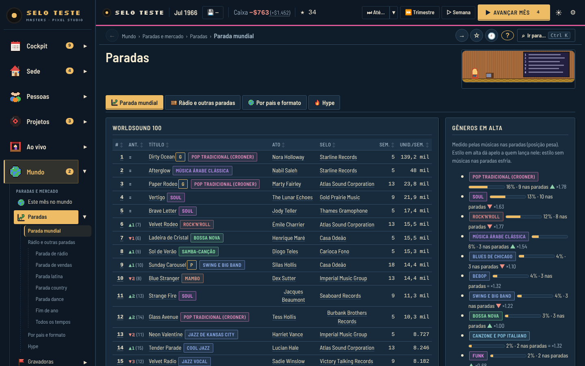
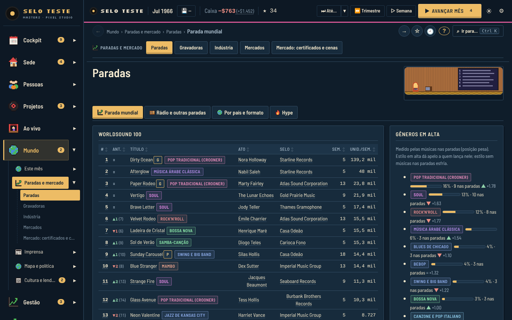
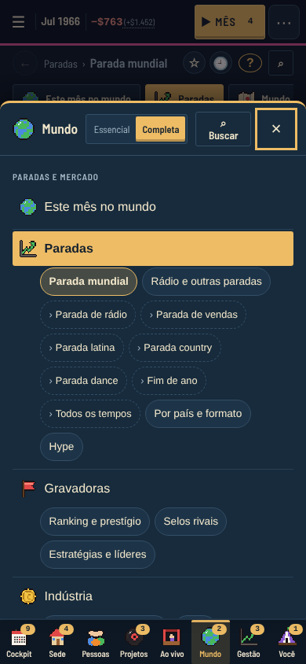
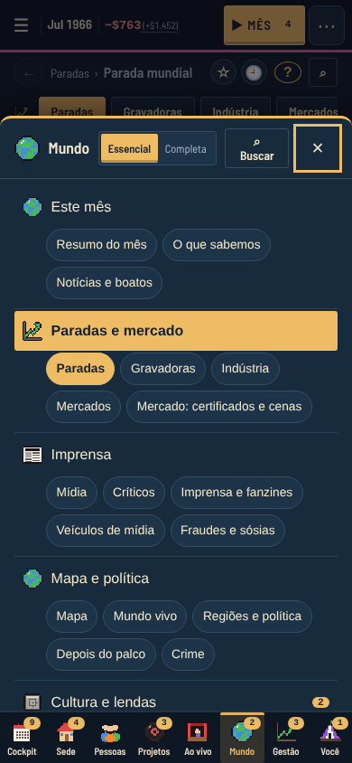
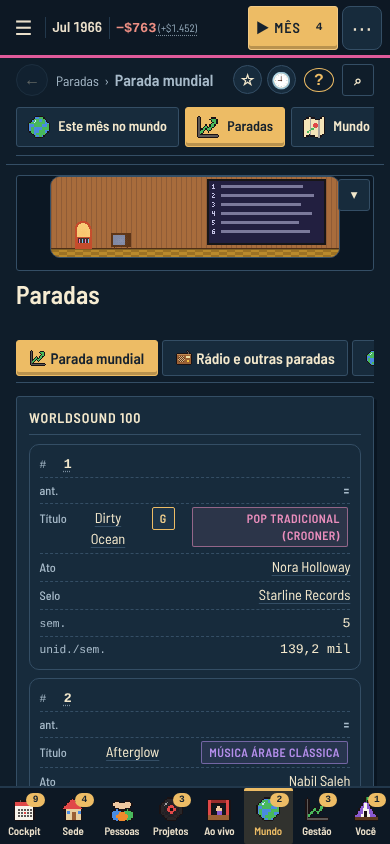
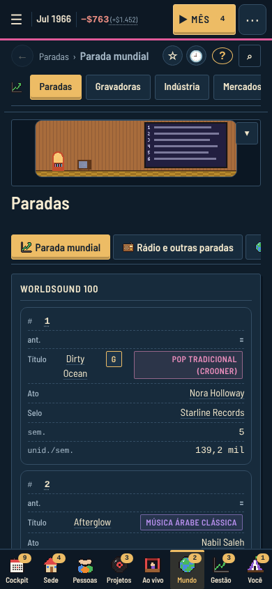
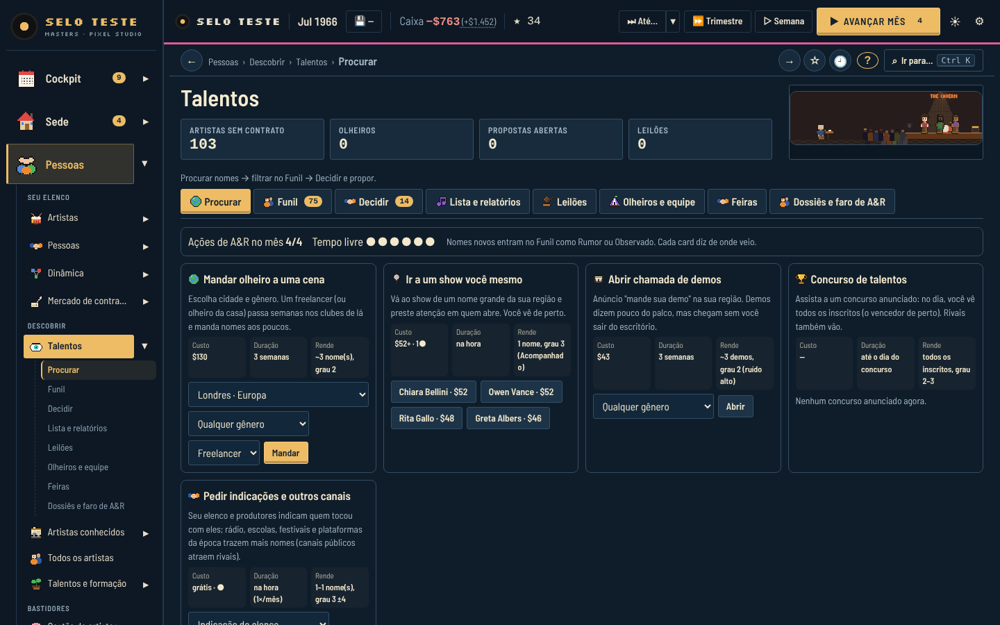
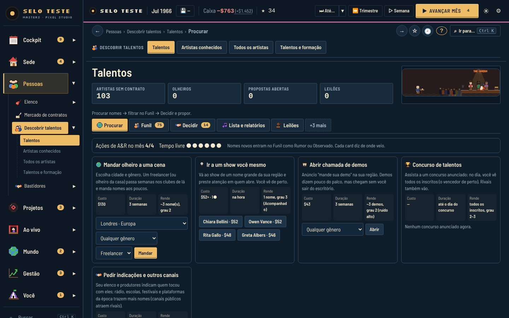
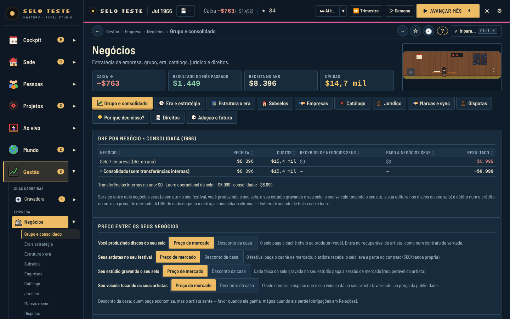
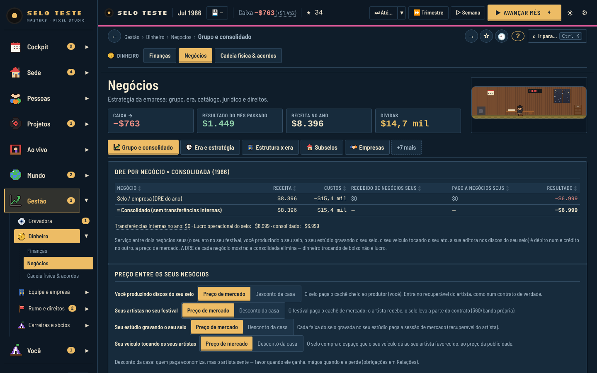

# Rodada 27 (UX) — menus, escolhas e usabilidade: menos portas, nada some

Pedido do dono: o jogo tem páginas e conteúdo demais e isso assusta. Regra: **não apagar nada** — no máximo
**unificar** (juntar páginas e abas que se sobrepõem, agrupar, divulgação progressiva, padrões melhores). Toda
função continua alcançável.

Código: `src/ui/ps/hub27model.ts` (hubs, sem DOM), `src/ui/ps/view27.ts` (vista Essencial × Completa, faixas
compactas), `src/ui/ps/tree27.ts` (menu), `src/ui/ps/pick27.ts` + `pick27model.ts` (controles de escolha),
`src/ui/ps/hub27.css`, `src/ui/ps/pick27.css`, ganchos em `src/ui/app.ts` e `src/ui/vis.ts`.
Testes: `tests/r27-ux.test.ts`. Capturas: `docs/screenshots/ux27/`.

---

## 1. Auditoria (antes)

Partida de teste: selo, 1965, 18 meses jogados pelo bot (`playMonth('balanced')` + `advanceMonth`), estado
injetado em `store.game`; Playwright + Chromium, todas as 79 páginas a 1440 e 390 px (script em
`/tmp`, não versionado; métricas por página: palavras acima da dobra, `<select>` visíveis, faixas e botões de
aba, botões, altura da página).

### 1.1 Tamanho da árvore

| Seção | Páginas | Abas internas (registro) | Temas |
|---|---:|---:|---:|
| Cockpit | 1 | 3 | 1 |
| Sede | 6 | 10 | 1 |
| Pessoas | 12 | 44 | 3 |
| Projetos | 9 | 31 | 2 |
| Ao vivo | 7 | 13 | 2 |
| **Mundo** | **23** | **102** | 5 |
| Gestão | 15 | 55 | 3 |
| Você | 6 | 25 | 1 |
| **Total** | **79** (+12 de carreira) | **~310** | 18 |

Páginas com faixa de abas longa: Negócios 12, Lendas 11, Direitos 10, Composição 9, Talentos 8, Finanças 8,
Mídia 8, Rumo do selo 8, Vida pessoal 8, Sede 7, Indústria 7.

### 1.2 O que mais pesa

1. **Mundo tem 23 páginas** num nível só. Aberto no computador, o menu da seção mostra 33 itens (páginas +
   abas da página atual + sub-abas); a folha do celular tem **123 botões** e 3,2 mil px de rolagem.
2. **O menu repete as abas** de cada página (Seção › Página › Aba › aba interna): a árvore inteira tem ~390
   linhas possíveis. No celular a folha da seção lista todas as abas de todas as páginas.
3. **Nomes que se confundem** (evidência: rótulos do menu):
   - "Sede" (página) × "Sua sede" × seção "Sede"; "Mundo" (página) × seção "Mundo"; "Pessoas" (página) × seção "Pessoas";
   - "Sociedades" (Gestão) × "Sociedade" (Mundo);
   - "Agenda e contratações" × "Agenda de shows" × "Calendário";
   - "Mídia" × "Veículos de mídia" × "Imprensa e fanzines" × "Críticos" (4 páginas de imprensa);
   - "Estúdio" × "Estúdio e produtor"; "Agente e promotor" (página) × "Agente e promotor" (carreira).
4. **Informação duplicada entre páginas**: caixa aparece na barra do topo, no Cockpit, em Finanças, em Negócios e
   nos KPIs de 6 páginas (é bom ter no topo; nas páginas, é o mesmo número); decisões no Cockpit (Agora),
   na Caixa de entrada e na Central; o calendário de shows em Shows › Agenda e em Agenda de shows; os artistas
   em Artistas, Pessoas, Dinâmica, Artistas conhecidos e Todos os artistas.
5. **Escolhas inconsistentes**: 86 `<select>` visíveis em 29 páginas (Projeto musical 11, Equipe e ritmo 7,
   Pessoas 6, Todos os artistas 6). Muitas têm 2–3 opções ("Foco/Normal/Mínimo", "Preço de mercado/Desconto da
   casa", "Mais recentes/Maior Q/Maior gancho") e escondem as alternativas atrás de um clique.
6. **Celular**: a faixa do topo listava **todas** as páginas da seção (Mundo: 22 botões rolando) mais as abas
   da página (mediana de 16 botões de faixa por página, máx. 33).
7. **Primeira partida**: a divulgação progressiva (`sys/ux19.ts`) já esconde páginas avançadas, mas no 1º mês o
   menu ainda mostra 42 páginas.

### 1.3 Cliques para as 10 tarefas mais comuns (computador, partindo do Cockpit)

"Opções" = quantas entradas a pessoa precisa varrer no passo em que escolhe a página (lei de Hick).

| Tarefa | Caminho antes | Cliques | Opções no passo | Caminho depois (Essencial) | Cliques | Opções |
|---|---|---:|---:|---|---:|---:|
| Contratar artista | Pessoas (abre Artistas) › Talentos › Decidir › Contratar | 4 | 12 | Pessoas › Descobrir talentos › Decidir › Contratar | 4 | **4** |
| Compor | Projetos (abre Projeto musical) › Composição › Compor | 3 | 9 | Projetos › 2·Compor (faixa) › Compor | 3 | **4** |
| Gravar | Projetos › Estúdio › Gravar | 3 | 9 | Projetos › 3·Gravar › Gravar | 3 | **4** |
| Lançar | Projetos › Lançamentos › Lançar | 3 | 9 | Projetos › 4·Lançar › Lançar | 3 | **4** |
| Marcar turnê | Ao vivo (abre Shows) › Turnês › Marcar | 3 | 7 | Ao vivo (abre Shows) › Turnês › Marcar | 3 | **2** |
| Ver o caixa | barra do topo (0) / Gestão › Finanças | 0 / 2 | 15 | barra do topo (0) / Gestão › Dinheiro | 0 / 2 | **5** |
| Responder decisão | Cockpit › Agora › Decidir | 1 | — | igual | 1 | — |
| Contratar equipe | Gestão › Agenda e contratações › Contratar › … | 4 | 15 | Gestão › Equipe e empresa › Contratar › … | 4 | **5** |
| Ver paradas | Mundo › Paradas | 2 | 23 | Mundo › Paradas e mercado | 2 | **5** |
| Salvar | 💾 na barra / Arquivo | 1 | — | igual | 1 | — |

Os cliques ficam iguais (nenhuma tarefa ficou mais longa — por isso "Equipe e empresa" abre na Agenda e
contratações e "Fazer um disco" mostra as 4 etapas na faixa); o que cai é o **tamanho da escolha** em cada passo
(média de 12,4 → 4,1 opções) e o **ruído** do menu. Ctrl+K continua sendo o atalho de 1 passo para tudo
(agora também acha os hubs pelo nome).

---

## 2. Nova arquitetura de informação

Mesmas 8 seções (Cockpit · Sede · Pessoas · Projetos · Ao vivo · Mundo · Gestão · Você). Dentro de cada seção,
em vez de páginas soltas agrupadas por tema, **hubs**: uma entrada do menu que junta as páginas do mesmo assunto.
Dentro do hub, uma **faixa de vistas** no topo da página (computador e celular) troca entre as páginas originais.

**É só uma camada de mapeamento**: os ids das páginas não mudam. Saves, rotas (`#/charts/...`), Ctrl+K,
atalhos de tecla, fixados ☆, recentes, `ALIAS17` (telas absorvidas pelas páginas de carreira) e todos os testes
antigos continuam iguais. Ids de hub também abrem: `#/hub:money` ou `go('hub:money')` vai para a última página
visitada no hub (ou a 1ª visível). Páginas novas de outras frentes (ex.: mercado de canções em Projetos) que
nenhum hub conhece aparecem como entrada solta na seção — nada some e nada precisa ser registrado aqui.

### 2.1 Páginas unificadas (antigo → novo)

| Seção | Hub (entrada nova) | Páginas que ele junta (ids antigos, todos continuam abrindo) |
|---|---|---|
| Cockpit | Cockpit | `cockpit` (sem mudança) |
| Sede | **Sua sede** | Sua sede `sede25` (vista "Cena da sede") · Sede `hq` ("Operação") · Nosso mundo `campus18` |
| | **Plano e metas** | Central `plan` · Metas `goals` · Diário da run `diary` |
| Pessoas | **Elenco** | Artistas `artists` · Pessoas `people` ("Saúde e relações") · Dinâmica `dyn18` |
| | **Contratos** | Mercado de contratos `contracts19` · Contratos do artista `artist18` |
| | **Descobrir talentos** | Talentos `market` · Artistas conhecidos `knownacts27` · Todos os artistas `directory` · Talentos e formação `talent18` |
| | **Bastidores** | Gestão de artistas `management` · Empresários `managers14` · Produtores `producers15` |
| Projetos | **Fazer um disco** | Projeto musical `project` ("1 · Projeto") · Composição `creation` ("2 · Compor") · Estúdio `studio` ("3 · Gravar") · Lançamentos `releases` ("4 · Lançar") |
| | **Catálogo e reviver** | Catálogo `catalog` · Tributos e covers `tribute19` · Remix, anúncios e trilhas `media19` |
| | **Estúdio e editora** | Estúdio e produtor `studio12` · Editora `publishing16` |
| Ao vivo | **Shows e turnês** | Shows `shows` · Agenda de shows `cal17` · Agente e promotor `tour12` · Palco e temporada `live19` |
| | **Festivais e prêmios** | Festivais `festivals` · Premiações `awards` · Hall da Fama `rockhall` |
| Mundo | **Este mês** | Este mês no mundo `mundo27` ("Resumo do mês") · O que sabemos `known27` · Notícias e boatos `news17` |
| | **Paradas e mercado** | Paradas `charts` · Gravadoras `labels` · Indústria `industry` · Mercados `regions18` · Mercado: certificados e cenas `market19a` · Plataforma `platform16` |
| | **Imprensa** | Mídia `media` · Críticos `critics` · Imprensa e fanzines `zines19` · Veículos de mídia `outlets16` · Fraudes e sósias `fakes19` |
| | **Mapa e política** | Mundo `world` ("Mapa") · Mundo vivo `world17` · Regiões e política `regions19` · Depois do palco `after18` · Crime `crime` |
| | **Cultura e lendas** | Lendas `lendas` · Relações e movimentos `movements` · Sociedade `society18` · Diário do Mestre `dm18` |
| Gestão | **Dinheiro** | Finanças `finance` · Negócios `business` · Cadeia física & acordos `supply18` |
| | **Equipe e empresa** | Agenda e contratações `agenda17` · Equipe e ritmo `team` · Empresa `company` · Crises, seguros e cultura `firm19` · Identidade `identity` · Negócios & direitos `biz17` |
| | **Rumo e direitos** | Rumo do selo `long18` · Calendário `calendar19` · Direitos `rights18` |
| | **Carreiras e sócios** | Carreiras `careers` · Empreendimentos `ventures` · Sociedades `shared18` |
| Você | **Você e família** | Você `you` ("Perfil") · Vida pessoal `personal` · Patrimônio e investimentos `wealth` |
| | **Noite e cenas** | Noite e encontros `night14` · Álbum de cenas `scenes17` |
| | Ajuda e tutorial | `tut18` (solta) |

Páginas de carreira (`cp17-*`) continuam entradas próprias, **no topo** da seção do ofício. Telas fora da sua
carreira e carreiras sem página caem como entradas soltas no fim da seção (como antes).

Resultado: **79 páginas → 25 entradas** (fora as páginas de carreira); nenhuma seção passa de 5 entradas
(Mundo: 23 → 5; Gestão: 15 → 4 + a página da carreira; Pessoas: 12 → 4; Projetos: 9 → 3).

Os nomes que se confundiam ficam desambiguados **pelo hub** (o nível do meio das migalhas passa a ser o hub:
"Mundo › Paradas e mercado › Paradas › Parada mundial") e por rótulos curtos só dentro da faixa de vistas
(`VIEW_LABEL27`: "Sede" vira "Operação" dentro de Sua sede; "Mundo" vira "Mapa"; "Pessoas" vira "Saúde e
relações"). O nome da página no menu Completo, no título e na busca não muda.

### 2.2 Vista Essencial × Completa (iniciante × completo)

Seletor no rodapé do menu (computador) e no topo da folha da seção (celular); lembrado neste navegador
(`localStorage` `vtn27.view`, conveniência — nunca estado do jogo).

- **Essencial (padrão)**: menu por hubs; o menu não lista abas (elas estão na página); faixas de abas com 7+
  abas mostram as 5 primeiras + a aberta e um botão **"+N mais"** (o título do botão lista as escondidas;
  clicar revela a faixa inteira até o fim da sessão).
- **Completa**: exatamente a árvore r27 (Seção › Tema › Página › Aba › aba interna) e todas as abas à mostra.

A divulgação progressiva da 1ª partida (`sys/ux19.ts`, "Mostrar tudo") continua valendo nas duas vistas.

---

## 3. Padrões de seleção

Regra única em `ps/pick27model.ts` (`pickKind27`):

| Situação | Controle | Componente |
|---|---|---|
| 1 escolha entre **2–4** opções curtas (≤ 16 caracteres): modo, período, ordem, nível de atenção | **Segmentado** — todas as opções à vista | `segmented27` |
| 1 escolha entre **5+** opções, ou nomes longos (artista, país, gênero, carreira) | **Lista** (`<select>`) | `select()` de `dom.ts` |
| Filtros que somam (0..n) sobre uma lista | **Chips** com "Limpar" | `chips27` |
| Escolha com consequência (custo, risco, efeito) | **Cartões de opção** — custo e efeitos antes do clique | `optionCards27` |
| Trocar de assunto na mesma página | **Abas** (não para filtrar listas) | `tabs()` de `vis.ts` |
| Trocar de página dentro de um hub | **Faixa de vistas** | `subnav()` em `app.ts` |

**Listas longas** usam a mesma barra: busca à esquerda, ordem (segmentado) e filtros (chips), contagem à
direita — `listBar27`. Ordenar por coluna em tabela continua com `sort22`/`sort27` (cabeçalho clicável ⇅).

**Conversão automática**: `enhanceSelects27` roda em toda página desenhada e troca cada `<select>` simples
com 2–4 opções curtas por um segmentado. O `<select>` continua no DOM (escondido) e recebe o valor e os eventos
`input`/`change` — os ~300 pontos que criam listas não precisaram mudar. Para manter uma lista, marque o
elemento (ou um ancestral) com `data-keep-select`. Setas ←/→ trocam a opção (role `radiogroup`/`radio`).

---

## 4. Celular

- Barra inferior com as 8 seções (sem mudança). A **folha da seção** na vista Essencial lista os hubs, cada um
  com as suas páginas como botões menores — sem as abas (que estão na página).
- A faixa do topo mostra **só as páginas do hub** (antes: todas as páginas da seção, até 22).
- Segmentados com ≥ 40 px de altura a 390 px.

---

## 5. Antes × depois (medido)

Mesmo estado de jogo; "antes" = vista Completa (idêntica à árvore r27) e o código antes da conversão de listas.

| Métrica | Antes | Depois |
|---|---:|---:|
| Entradas de menu (todas as seções, todas as carreiras, fora as de carreira) | 79 páginas | **25** |
| Itens visíveis na seção aberta, computador (Sede / Pessoas / Projetos / Ao vivo / Mundo / Gestão / Você) | 13 / 19 / 18 / 11 / **33** / 22 / 17 | 5 / 8 / 7 / 6 / **10** / 8 / 6 |
| Botões no menu lateral com Mundo aberto | 67 | **36** |
| Palavras no menu lateral com Mundo aberto | 140 | **65** |
| Botões na folha do celular (Sede / Pessoas / Projetos / Ao vivo / Mundo / Gestão / Você) | 16 / 50 / 40 / 19 / **123** / 76 / 31 | 8 / 14 / 12 / 8 / **27** / 18 / 8 |
| Altura da folha do celular, Mundo | 3.248 px | **707 px** |
| Botões de faixa (páginas) no topo, celular — soma das 79 páginas / mediana / máx. | 1.004 / 11 / 22 | **257 / 3 / 5** |
| Botões de aba visíveis na página — soma / máx. | 280 / 12 | **250 / 8** |
| `<select>` visíveis (todas as páginas) | 86 em 29 páginas | **63 em 25** (23 viraram segmentado) |
| Palavras acima da dobra, celular — mediana | 128 | **111** |
| Botões visíveis por página, celular — mediana | 40 | **30** |

No computador a faixa de vistas aparece agora também (mediana de 3 botões por página), em troca de a página
deixar de depender do menu lateral para mostrar as irmãs.

Capturas (`docs/screenshots/ux27/`):

| | Antes | Depois |
|---|---|---|
| Menu com Mundo aberto (1440) |  |  |
| Folha do celular, Mundo (390) |  |  |
| Paradas no celular (390) |  |  |
| Pessoas › Talentos (1440) |  |  |
| Gestão › Negócios (1440): faixa "+7 mais", segmentados |  |  |

---

## 6. Garantias (testes)

`tests/r27-ux.test.ts`:
- cada página está em no máximo um hub, todo hub fica numa seção só e só junta páginas que existem;
- na vista Essencial, **toda página do menu aparece em exatamente uma entrada**, em 17 combinações de carreiras;
- ≤ 5 entradas por seção (fora as de carreira) e menos da metade das páginas em entradas;
- **todo id antigo de página resolve** (direto, pela página de carreira via `ALIAS17` ou por hub) e toda página
  com abas no registro continua alcançável;
- ids `hub:<id>` abrem a última página visitada no hub ou a 1ª visível;
- regras de escolha (`pickKind27`) e da faixa compacta (`shownTabs27`).

Os testes antigos do menu (`r27-nav`, `r25-nav`, `r17-nav`, `r16-menus`, `r15-nav`, `r14-shell`,
`r27-cockpit`, …) continuam verdes sem mudança: `navGroups25` não mudou — os hubs só reagrupam a saída dele.

## 7. Próximos passos sugeridos (não feitos aqui)

- Usar `listBar27` nas listas longas (Todos os artistas, Artistas conhecidos, Talentos) — deixado para depois da
  unificação de olheiros/casas/festivais que está em andamento em outra frente.
- Trocar escolhas com custo/efeito em texto corrido (ex.: "Orçamento estourado" no Projeto) por `optionCards27`.
- Cortar números repetidos nos KPIs das páginas quando já estão na barra do topo (caixa).
